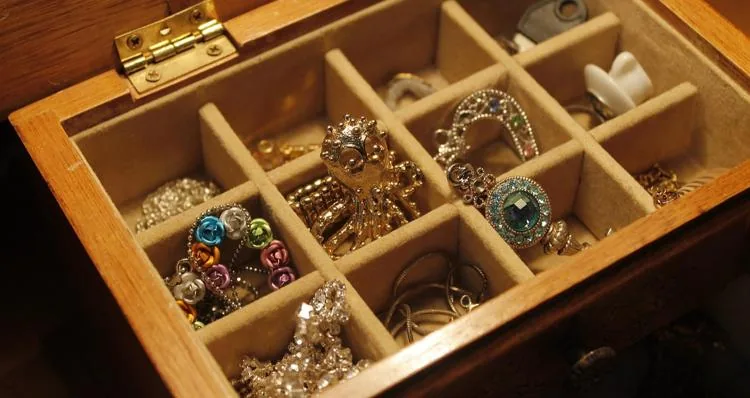

Sylvie fabrique des bijoux fantaisie, en particulier des colliers artisanaux. Elle cherche à optimiser son activité en étudiant le coût de production de ses créations.

Le coût de production hebdomadaire $C(x)$, en euro, est modélisé par la fonction : $C(x) = 0{,}5x^2 - 20x + 500$ définie sur $[1;100]$ où $x$ représente le nombre de pièces produites.

::: problematique
Combien de colliers doit-elle fabriquer pour avoir un coût de production minimal ?
:::

1. À quoi correspond $x$ ? À quoi correspond $C(x)$ ?

2. Calculer le coût de production pour 10 pièces produites puis pour 20 pièces produites.

3. Déterminer la dérivée de la fonction $C$.

   ::: coup-de-pouce x-derivees
   :::

4. Résoudre l'équation $C'(x) = 0$.

   ::: coup-de-pouce x-equation-video
   :::

5. Dresser le tableau de signes de $C'(x)$.

   ::: coup-de-pouce m-signe-derivee
   :::

6. En déduire les variations de la fonction $C$.

7. La fonction $C$ admet-elle un minimum ou un maximum ? Donner sa valeur.

8. En déduire le nombre de pièces produites pour lequel le coût de production est minimal.

9. Répondre à la problématique.
