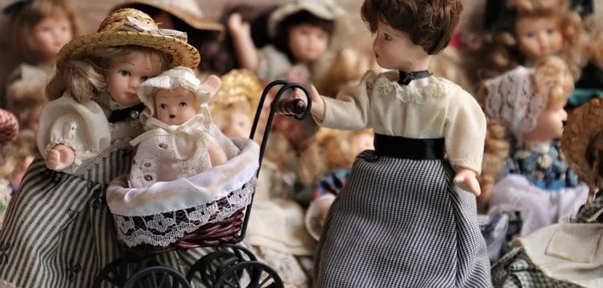

Une société fabrique de nouveaux modèles de poupées haute couture pour les grandes marques de luxe. Le coût total de production hebdomadaire est modélisé par la fonction $C$ telle que : $C(x) = 0{,}5x^2+50x+100$ définie sur $[5\,;100]$ avec $x$ le nombre de poupées fabriquées.

::: problematique
Quelle quantité de poupées la société doit-elle produire pour obtenir un coût moyen hebdomadaire minimum ?
:::

1. À quoi correspond $x$ ? À quoi correspond $C(x)$ ?

2. Calculer le coût de production pour 5 poupées fabriquées.

3. Interpréter le résultat obtenu.

4. Le coût moyen $C_M$ correspond au coût unitaire du produit fabriqué et il est calculé en divisant le coût de production $C$ par le nombre de produits fabriqués $x$.

   $C_M(x)= \frac{C(x)}{x}$ avec $x$ non nul.

   Montrer que $C_M(x)= 0{,}5x + 50 + \frac{100}{x}$.

5. On admet que $C_M(x) = 0{,}5x + 50 + \frac{100}{x}$.

   Calculer la dérivée de $C_M$.

   ::: coup-de-pouce x-derivees
   :::

6.
   1. Tracer la courbe de la fonction dérivée $C_M'$ à l'aide de l'outil GeoGebra ci-dessous.

      ::: coup-de-pouce m-tracer-geogebra
      :::

      ::: ouvrir https://www.geogebra.org/classic/jxhd6xur
      :::

   2. Résoudre graphiquement l'équation $C'_M(x) = 0$ (arrondir la solution à l'unité).

      ::: coup-de-pouce x-equation-graphique
      :::

   3. Dresser le tableau de signes de $C_M'$. Pour répondre à cette question, appuyez-vous sur la représentation graphique de la fonction dérivée.

      ::: coup-de-pouce m-signes-graphique
      :::

   4. En déduire les variations de $C_M$.

7. La fonction $C_M$ admet-elle un maximum ou un minimum ? Préciser sa valeur.

8. En déduire le coût moyen minimum.

9. Répondre à la problématique.
