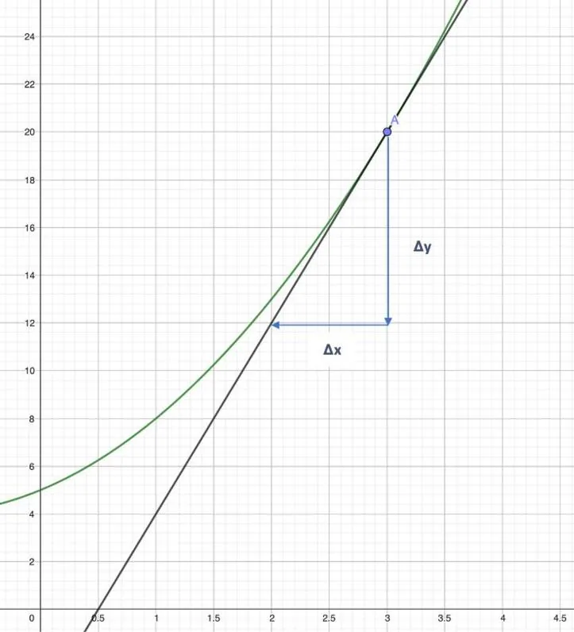

Le coût marginal pour une production $x$ est environ égal au nombre dérivé $C'(x)$, c'est-à-dire au coefficient directeur de la tangente à la courbe de $C$ au point d'abscisse $x$. On peut donc l'estimer sur un graphique.

**Exemple**

Le coût de fabrication d'une société de savons artisanaux, en euro, est modélisé par la fonction suivante : $C(x) = x^2 +2x + 5$ définie sur l'intervalle $[1\,;30]$, où $x$ représente le nombre de savons produits chaque semaine.

On souhaite déterminer graphiquement le coût marginal pour une production de 3 savons (point A de la courbe, d'ordonnée 20).

On note $a$ le coefficient directeur de la droite tangente au point A.

On calcule la pente $a$ : $a = \frac{\Delta y}{\Delta x}$.

**Astuce :** bien observer les flèches en partant du point A puis réaliser le parcours de l'axe vertical vers l'axe horizontal.

Ici en partant de A, on descend de 4 carreaux, ce qui équivaut avec l'échelle à $-8$ et on recule de 2 carreaux, soit $-1$.

$a = \frac{-8}{-1}$

$a = 8$

Donc $C'(3) = 8$ : quand 3 savons sont déjà produits, fabriquer un savon de plus coûte environ 8 €.
