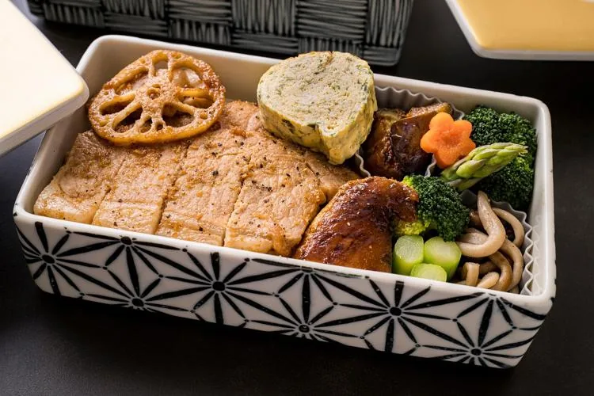

Une entreprise fabrique des lunch box. Le coût total de production (en centaine d’euros) est modélisé par la fonction : $C(x)=0{,}2x^2+3x+50$ où $x$ représente le nombre de centaines de lunch box produites pour $x \in [0\,;50]$.

Attention : pour $x = 2$, on parle de 2 centaines de lunch box, soit 200 lunch box.

Le prix de vente unitaire est fixé à 12 € par lunch box.

1. Déterminer le coût de production de 1 000 lunch box, c'est-à-dire pour $x = 10$.

2. Déterminer le coût moyen d'une lunch box pour cette production.

3. Déterminer le coût marginal $C_m(10)$.

4. Déterminer le chiffre d'affaires réalisé pour une production de 1 000 lunch box.

5. En déduire le résultat et dire si l'entreprise réalise un bénéfice ou subit une perte.

6. En analysant les réponses des questions 2, 3 et 5, dire si la production de 1 000 lunch box est rentable pour l'entreprise.
