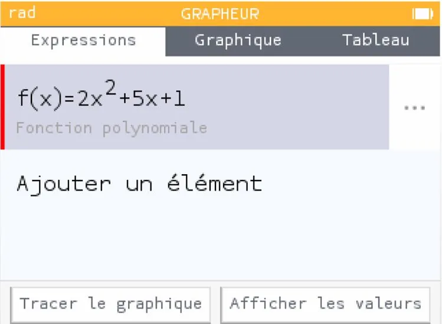
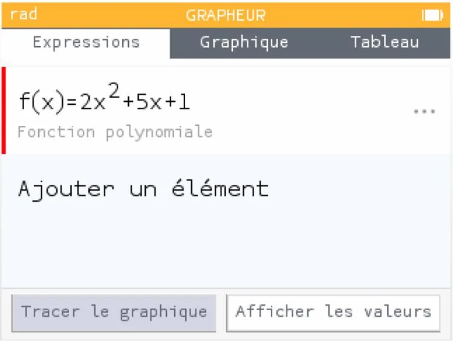
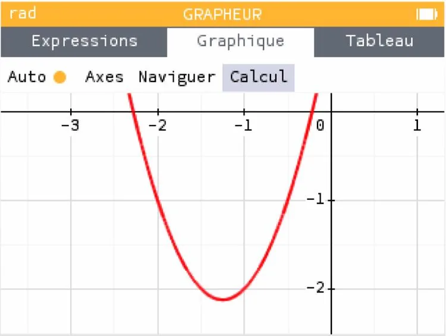
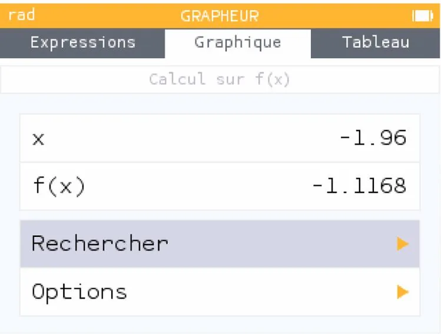
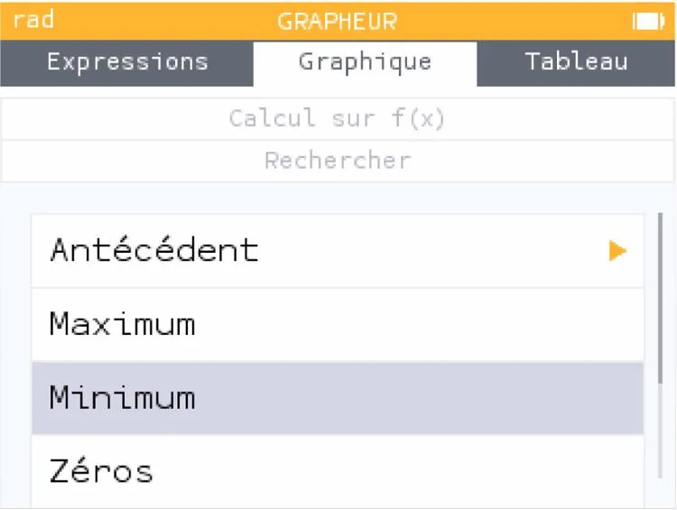
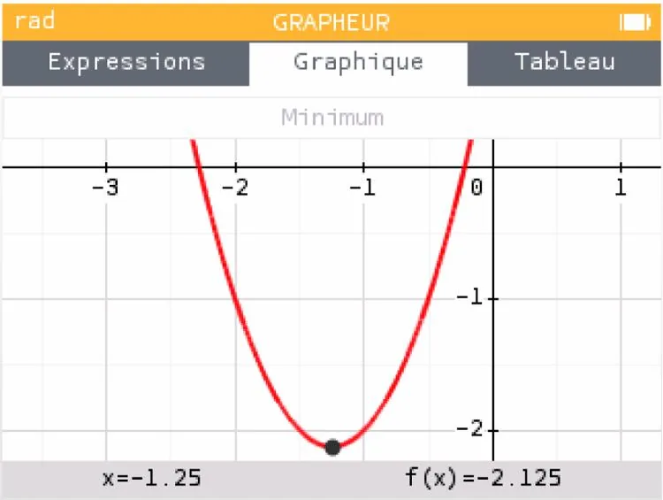

Déterminons si une fonction possède un minimum ou un maximum à l'aide de la représentation graphique de $f(x) = 2x^2+5x+1$ sur l'intervalle $[-3\,;2]$.

1. Aller dans l'application **« Grapheur »**.

   

2. Rester dans l'onglet **« Expressions »** et saisir l'expression de la fonction $f$.

   

3. À l'aide des flèches, cliquer sur **« Tracer le graphique »**.

   

4. Dans l'onglet **« Graphique »**, aller sur **« Calcul »** puis cliquer sur OK.

   

5. La fenêtre suivante apparaît. Aller sur l'onglet **« Rechercher »** puis cliquer sur OK.

   

6. Sélectionner **« Minimum »** puisqu'on remarque que la fonction $f$ admet un minimum.

   

7. Les coordonnées du point minimum de la fonction $f$ apparaissent en bas du graphique : elle admet un minimum de $-2{,}125$ pour $x = - 1{,}25$.

   
