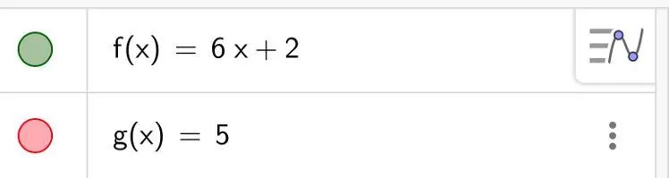
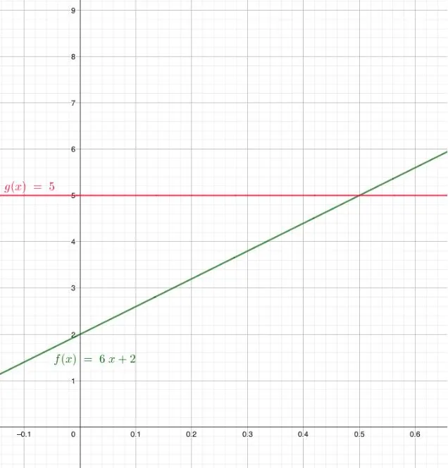
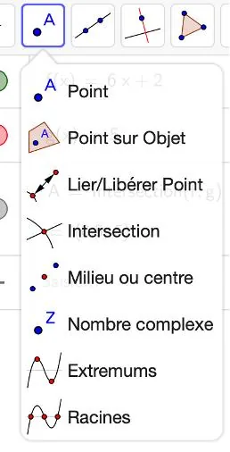
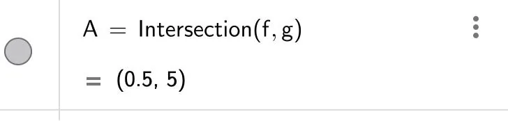

Résolution graphique de l'inéquation $6x + 2 > 5$ sur l'intervalle $[0\,;0{,}8]$.

1. Dans la barre de saisie, écrire l'expression algébrique des deux membres de l'inéquation.

   

2. Cliquer sur **« Déplacer graphique »** afin de visualiser l'intersection entre les deux droites.

   

3. Dans les outils, sélectionner **« Intersection »** puis cliquer sur les deux droites.

   

4. Dans la fenêtre Algèbre, lire les coordonnées du point d'intersection (ici $x = 0{,}5$).

   

5. Les solutions de l'inéquation $6x+2 >5$ sont l'ensemble des abscisses supérieures à la valeur $x = 0{,}5$ et comprises dans l'intervalle de définition de la fonction, c'est-à-dire les solutions comprises dans l'intervalle $]0{,}5\,; 0{,}8 [$.
