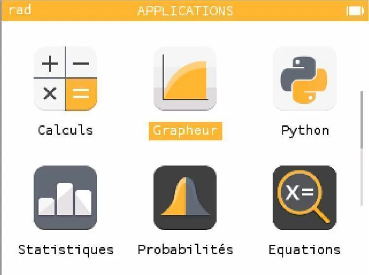
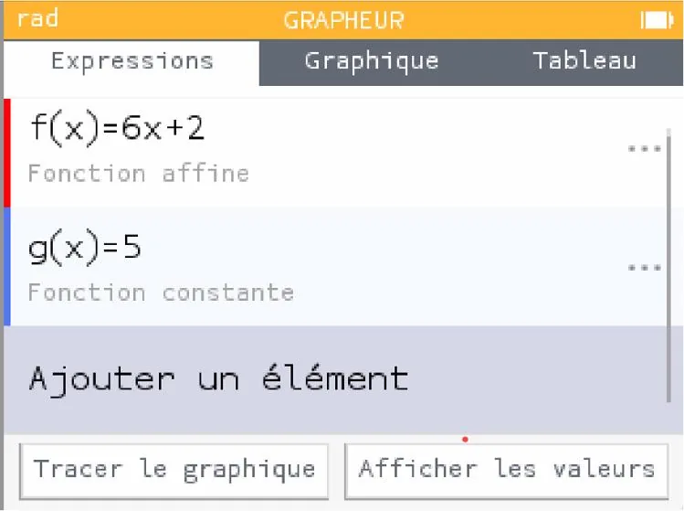
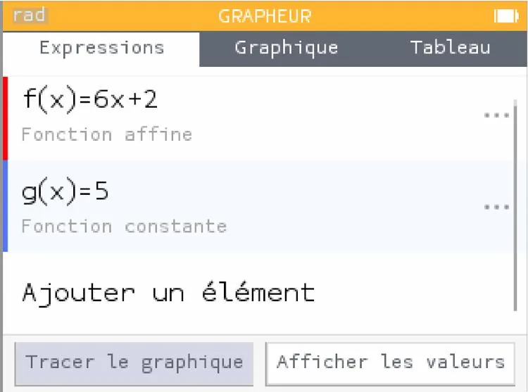
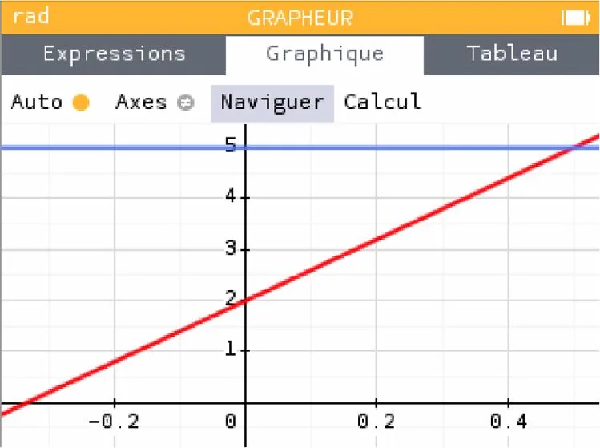
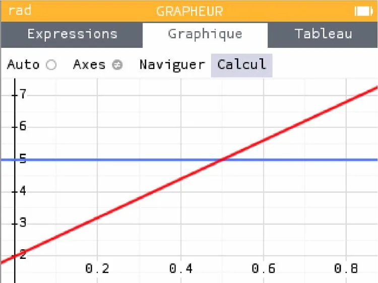
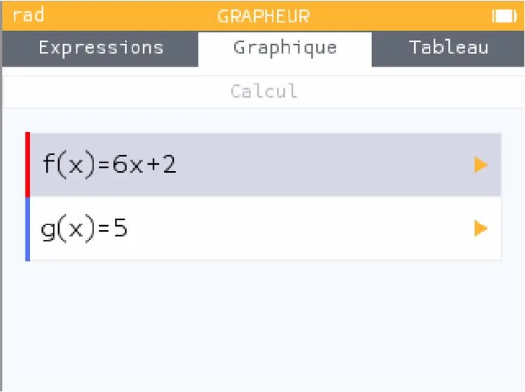
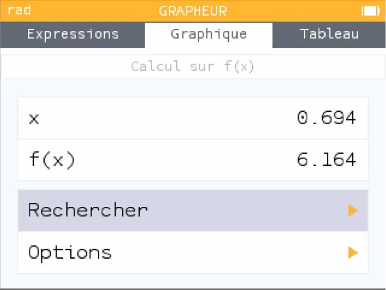
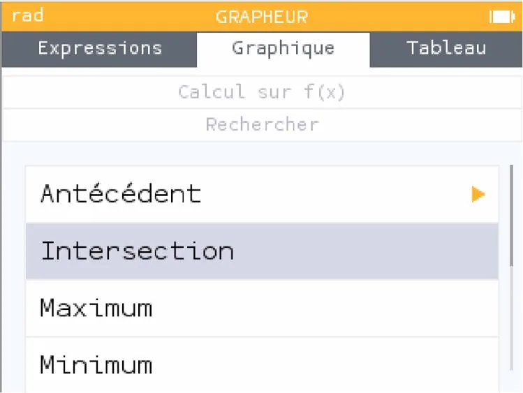
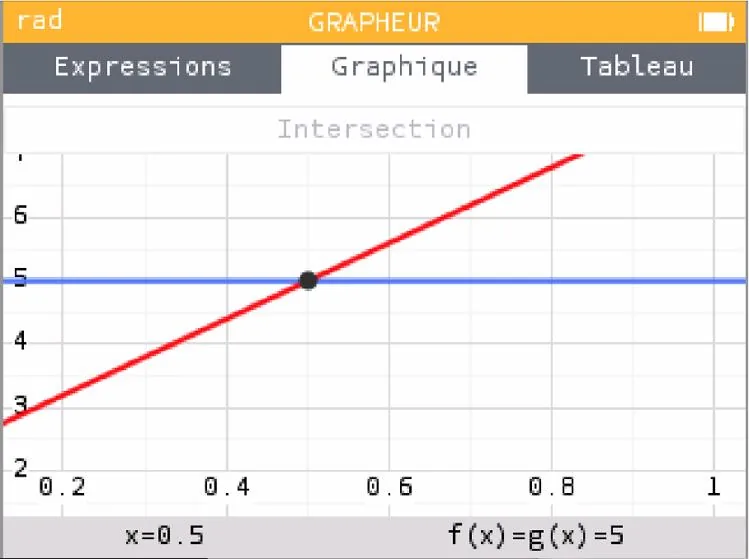

Résolvons graphiquement l'inéquation $6x + 2 > 5$ sur l'intervalle $[0\,;0{,}8]$.

1. Aller dans l'application **« Grapheur »**.

   

2. Rester dans l'onglet **« Expressions »** et saisir :

   - l'expression de la fonction $f$ ;
   - l'expression de l'équation de la droite $y = 5$ (nommée $g(x)$).

   

3. À l'aide des flèches, cliquer sur **« Tracer le graphique »**.

   

4. À l'aide des flèches, cliquer sur **« Naviguer »** puis sur OK pour déplacer le graphique afin d'observer le point d'intersection entre les deux droites.

   

5. Dans l'onglet **« Graphique »**, aller sur **« Calcul »** puis cliquer sur OK.

   

6. La fenêtre suivante apparaît, rester sur la fonction $f$ puis cliquer de nouveau sur OK.

   

7. Cliquer sur l'onglet **« Rechercher »**.

   

8. Puis cliquer sur **« Intersection »**.

   

9. Un point d'intersection apparaît. Son abscisse s'affiche en bas du graphique (ici $x = 0{,}5$).

   

10. Les solutions de l'inéquation $6x+2 >5$ sont l'ensemble des abscisses supérieures à la valeur $x = 0{,}5$ et comprises dans l'intervalle de définition de la fonction, c'est-à-dire les solutions comprises dans l'intervalle $]0{,}5\,; 0{,}8 [$.
