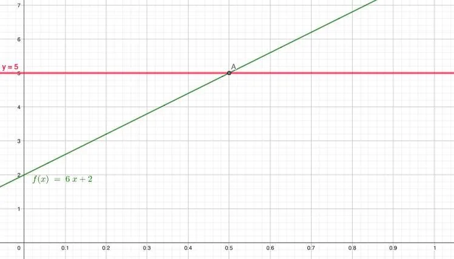

Il est nécessaire d'avoir au préalable identifié les coordonnées du point d'intersection. Les solutions sont alors les abscisses inférieures à celles du point d'intersection dans le premier cas ou supérieures à celles du point d'intersection dans le second cas.

**Étape 1.** Tracer sur le graphique la droite d'équation $y = c$ et la courbe $C_f$.

**Étape 2.** Déterminer l'abscisse du point d'intersection entre la droite d'équation $y = c$ et la courbe $C_f$.

### Étape3

- Pour une inéquation du type $f(x) < c$, les solutions sont les abscisses des points qui se situent en dessous de la droite d'équation $y = c$.
- Pour une inéquation du type $f(x) > c$, les solutions sont les abscisses des points qui se situent au-dessus de la droite d'équation $y = c$.

**Exemple**

Soit la fonction $f(x) = 6x + 2$ définie sur l'intervalle $[0\,; 0{,}8]$. On veut résoudre graphiquement $f(x) > 5$.

1. On trace sur le graphique la droite d'équation $y = 5$ et la courbe $C_f$.

   

2. On détermine l'abscisse du point d'intersection entre la droite d'équation $y = 5$ et la courbe $C_f$. D'après le graphique, l'abscisse du point d'intersection est $x = 0{,}5$.

3. Pour une inéquation du type $f(x) > 5$, les solutions sont les abscisses des points qui se situent au dessus de la droite d'équation $y = 5$.

   L'ensemble des solutions de cette inéquation sont donc les abscisses qui appartiennent à l'intervalle $] 0{,}5\, ; 0{,}8 [$.
