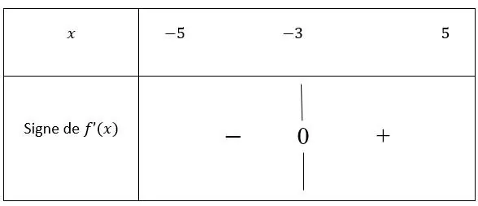

Quand on veut connaître les variations (croissance ou décroissance) d’une fonction, on doit étudier le signe de sa dérivée.

**Étape 1.** Calculer la dérivée de la fonction.

**Étape 2.** Étudier le signe de cette dérivée sur l’intervalle donné.

**Étape 3.** Établir un tableau de signes de la dérivée.

**Exemple**

Soit la fonction $f(x) = x^2 + 6x$, définie sur l’intervalle $[-5\,;5]$.

1. On dérive la fonction : $f'(x) = 2x + 6$.

2. On étudie le signe de $f'(x) = 2x + 6$ sur l’intervalle $[-5\,;5]$. Cela signifie qu’on va chercher quand la dérivée est positive, négative ou nulle, entre $x = -5$ et $x = 5$.

   **Astuce :** commencer par chercher la ou les solutions pour $f'(x) = 0$. Ici, $f'(x) = 0$ a pour solution $x = -3$. Pour étudier le signe de $f'$, choisir une valeur dans $[-5\,;-3]$, puis faire de même avec une valeur de $[-3\,;5]$.

   - Sur $[-5\,;-3]$, je choisis le nombre $-4$ : $f'(-4) = 2 \times (-4) + 6 = -8 + 6 = -2$. Sur $[-5\,;-3]$, $f'$ est négative.
   - Sur $[-3\,;5]$, je choisis le nombre $2$ : $f'(2) = 2 \times 2 + 6 = 4 + 6 = 10$. Sur $[-3\,;5]$, $f'$ est positive.

3. On remplit le tableau de signes de la fonction dérivée.

   
