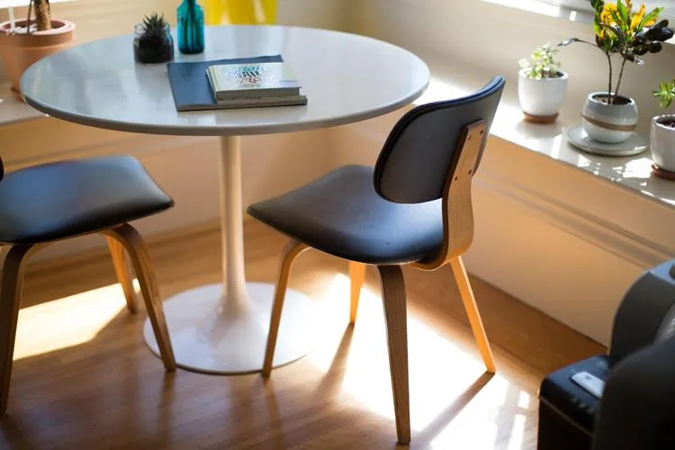

Une entreprise fabrique des meubles en kit (tables, étagères, bureaux) dans un petit atelier de menuiserie. Le coût total de production, qui comprend les matériaux (bois, visserie), les salaires, l’électricité, l’entretien des machines, etc., est modélisé par la fonction suivante : $C(x)=0{,}1x^2+10x+400$ avec $x \in [0\,;200]$ et $x$ le nombre de meubles fabriqués.

Chaque meuble est vendu 40 €. La vente est modélisée par la fonction : $V(x)=40x$.

On considère la fonction $R$ représentant le résultat réalisé par l'entreprise.

:::: competence Réaliser

1. Calculer le coût de production des meubles pour $x = 5$.

2. Calculer le coût moyen par produit pour $x = 5$.

3. Calculer le coût marginal pour $x = 5$.

4. Calculer le chiffre d'affaires réalisé pour $x = 5$.

::::

:::: competence Analyser-raisonner

5. En s'appuyant sur les résultats des questions 1 à 4, interpréter les valeurs du coût moyen et du coût marginal.

6. Montrer que $R(x) = -0{,}1x^2+30x - 400$.

::::

:::: competence Réaliser

7. Calculer le résultat obtenu pour $x = 5$.

::::

:::: competence Communiquer

8. Dire si l'entreprise a réalisé un bénéfice ou une perte.

   

::::
