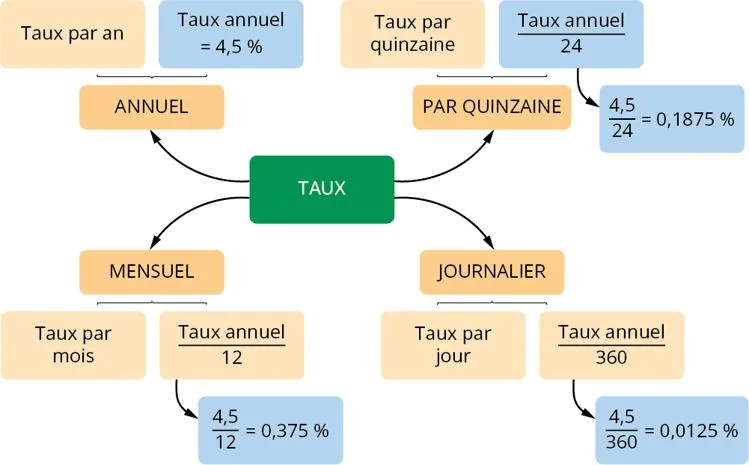

**Définition :** le taux d'intérêt périodique est le taux d'intérêt appliqué pour chaque période de temps fixe, telle qu'un jour, une quinzaine, un mois ou un an.

::: important
Une année financière compte 12 mois, 24 quinzaines ou 360 jours.
:::

**Exemple**

La même carte, en version interactive :

::: ouvrir https://view.genially.com/67e1c3ec298c6437d1fd6285/horizontal-infographic-diagrams-taux-dinteret-periodique
:::
