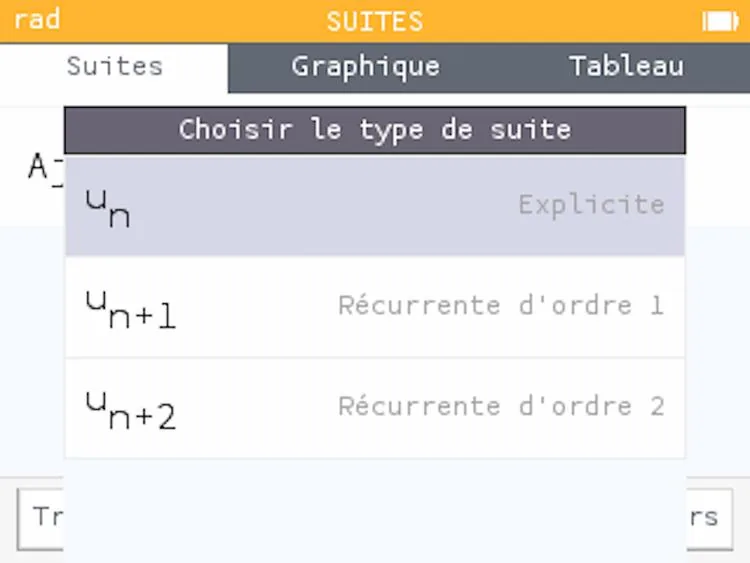
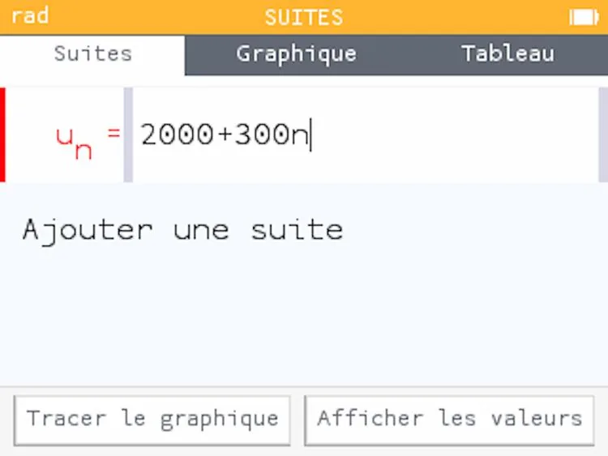
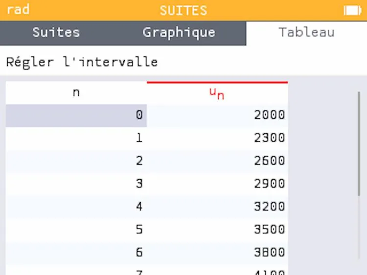

1. Ouvrir NumWorks.

   

2. Descendre dans le menu à l'aide des flèches, sélectionner **« Suites »** puis cliquer sur OK.

   

3. **« Ajouter une suite »** est sélectionné. Cliquer sur OK.

   

4. La suite de type **« Explicite »** est sélectionnée. Cliquer sur OK.

   

5. Saisir la formule explicite de la suite puis cliquer sur OK. Pour saisir la lettre $n$, appuyer sur cette touche :

   

   

6. À l'aide des flèches de la calculatrice, cliquer sur **« Afficher les valeurs »**.

   
