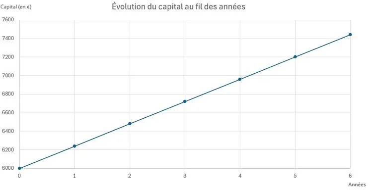

Sana place 6 000 euros durant 6 ans sur un plan épargne étudiant au taux d’intérêt simple de 4 % par an. Pour financer ses études, elle décide de débloquer cette somme au bout de 4 ans 9 mois et 18 jours.

::: problematique
Quel montant Sana a-t-elle perdu en débloquant son plan épargne étudiant avant l’échéance prévue ?
:::

On dispose du graphique suivant qui donne l’évolution du capital au fil des années (arrondi à l’euro près).

1. Quel est le montant du capital investi ?

2. À l'aide du graphique, déterminer le montant du capital disponible au bout de 3 ans.

3.
   1. À l'aide du graphique, déterminer le montant des intérêts acquis après 1 an d'épargne.
   2. En déduire, par le calcul, le montant du capital disponible au bout de 4 ans. Vérifier cette information par une lecture graphique.

4. Calculer le montant des intérêts acquis en 9 mois.

5. Calculer le montant des intérêts acquis en 18 jours.

6. En déduire le montant de la valeur acquise au bout de 4 ans 9 mois et 18 jours.

7. Quelle aurait été la valeur acquise par Sana au bout des 6 ans si elle n’avait pas retiré son capital de manière anticipée ?

8. Répondre à la problématique.
