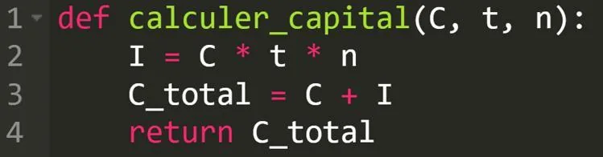

**Définition :** en langage Python, **def** est un mot-clé qui sert à définir une fonction. Une fonction est un petit programme réutilisable plusieurs fois sans réécrire le code à chaque fois.

**Exemple**

**Ligne 1 :** on déclare une fonction appelée **calculer_capital**, qui prend trois arguments (ou paramètres) :

- C (capital)
- t (taux)
- n (durée en années)

**Définition :** les arguments (ou paramètres) d'une fonction sont les valeurs que l'on donne à la fonction pour qu'elle puisse effectuer son action. Ici, on a trois paramètres pour réaliser l'action de calculer le capital total.

**Ligne 2 :** la fonction calcule les intérêts simples avec la formule mathématique.

**Ligne 3 :** la fonction calcule la valeur acquise (capital + intérêts).

**Ligne 4 :** la fonction renvoie le résultat final, que le programme pourra utiliser ailleurs.
