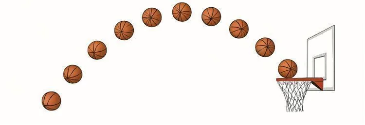
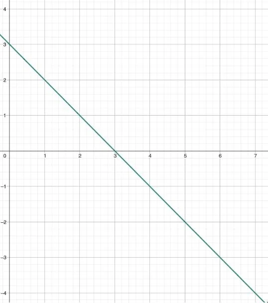
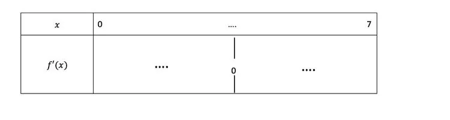
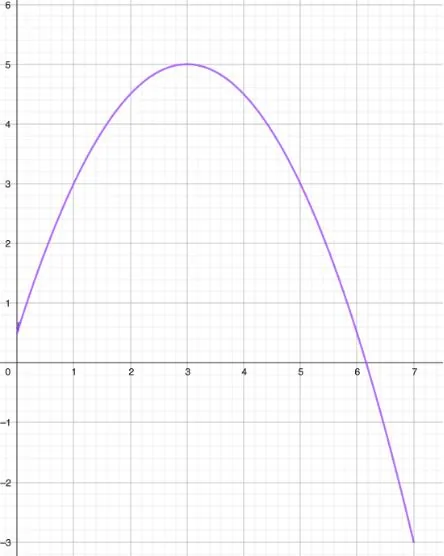
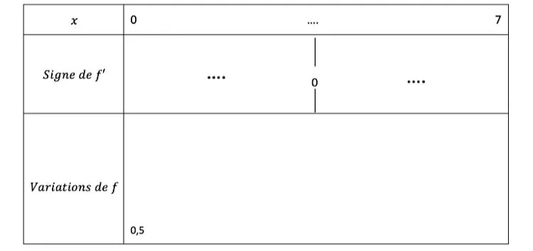

Nolan occupe le poste d'ailier dans son équipe de basket-ball. Son équipe est menée de 2 points. Il ne reste que 5 secondes avant la fin du match et il aimerait tenter un panier à 3 points. Nolan lance un tir dont la trajectoire est modélisée par la fonction : $f(x)=-0{,}5x^2+3x+0{,}5$ définie sur l'intervalle $[0\,;7]$ où $x$ est le temps exprimé en seconde depuis le lancer et $f(x)$ la hauteur du ballon en mètre.

Le panier est à une hauteur de 3,15 mètres.

::: problematique
Nolan va-t-il réussir son panier à 3 points et donner la victoire à son équipe ?
:::

1. Que représente la fonction $f$ ? À quoi correspond la variable $x$ ?

2. Calculer $f(2)$ et interpréter le résultat.

3. Calculer la fonction dérivée de $f$.

   ::: coup-de-pouce c-fonctions-derivees
   :::

4. On souhaite étudier le signe de la fonction dérivée sur l'intervalle $[0\,;7]$. Voici sa représentation graphique.

   

   1. Sur quel intervalle de $[0\,;7]$ la fonction $f'$ se situe-t-elle au-dessus de l'axe des abscisses ?

   2. Pour quelle valeur de $[0\,;7]$ la fonction $f'$ coupe-t-elle l'axe des abscisses ?

   3. Sur quel intervalle de $[0\,;7]$ la fonction $f'$ se situe-t-elle en dessous de l'axe des abscisses ?

5. Recopier et compléter le tableau de signes de la fonction $f'$ ci-dessous.

   ::: coup-de-pouce x-signe-graphique
   :::

   

6. Voici la représentation graphique de la fonction $f$.

   

   À partir des connaissances de seconde, en déduire les variations de la fonction $f$ et recopier puis compléter le tableau de variations suivant.

   ::: coup-de-pouce x-variations
   :::

   

7. Compléter les phrases suivantes avec le mot *positif* ou *négatif* :

   1. Lorsque la fonction $f$ est croissante, la fonction dérivée $f'$ a un signe...
   2. Lorsque la fonction $f$ est décroissante, la fonction dérivée $f'$ a un signe...

8. La fonction $f$ admet un extremum. Préciser sa valeur.

   ::: coup-de-pouce x-extremum
   :::

9. À partir des questions **6**, **7** et **8**, construire les éléments de réponse pour répondre à la problématique.
