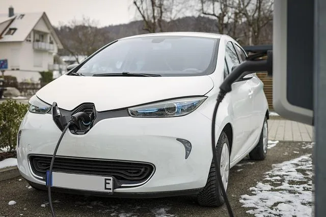

Un constructeur automobile conçoit une nouvelle voiture électrique. Il souhaite optimiser la vitesse pour que la consommation d’énergie soit la plus faible possible. Des tests ont permis de modéliser la consommation d’énergie (en kWh pour 100 km) en fonction de la vitesse $v$ (en km/h) avec la fonction $C(v)=0{,}01v^2-0{,}5v+10$ définie sur $[0\,;100]$.

::: problematique
Comment déterminer la vitesse à laquelle la voiture consomme le moins d’énergie ?
:::

1. À quoi correspond la fonction $C$ ? Que représente la variable $v$ ?

2. Calculer $C(10)$ et conclure.

3. Le problème est modélisé par la fonction $f$ telle que : $f(x)=0{,}01x^2-0{,}5x+10$ définie sur l'intervalle $[0\,;100]$.

   On se propose d'étudier le comportement du nombre dérivé en plusieurs points de la courbe de la fonction $f$ à l'aide de GeoGebra.

   ::: ouvrir https://www.geogebra.org/classic/tsudqxxp
   :::

   Dans le fichier GeoGebra ci-dessus, réaliser les manipulations du tutoriel.

   ::: coup-de-pouce x-tutoriel-tangente
   :::

4. Que constate-t-on lorsqu'on affiche la trace du point P ?

5. Dans la fenêtre Algèbre de GeoGebra, saisir la commande **Dérivée(f)**.

   Que constate-t-on ?

6. Donner l'expression de la fonction dérivée de $f$ que l'on nommera $f'$ puis en déduire l'expression de $C'(v)$.

7. La fonction dérivée correspond ici à la variation de la consommation en fonction de la vitesse. La consommation est minimale lorsque la dérivée s'annule.

   Résoudre l'équation $C'(v)= 0$.

8. En déduire la vitesse à laquelle la voiture consomme le moins d'énergie.

9. Répondre à la problématique.
