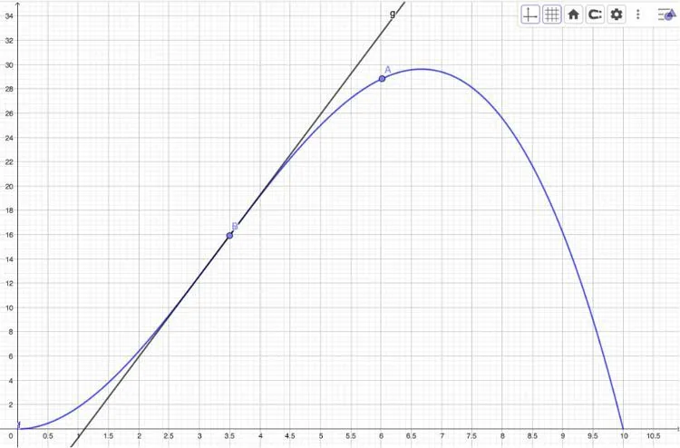

Josselyn participe à une descente chronométrée sur une piste de VTT. Un radar pédagogique a été installé à mi-parcours pour afficher la vitesse des participants, afin de les sensibiliser à leur allure.

Malheureusement, le radar ne fonctionne pas. Cependant, un capteur placé au départ a enregistré la distance parcourue par Josselyn (en mètres) en fonction du temps (en secondes). Cette distance parcourue est modélisée par la fonction : $f(t)=-0{,}2t^3+2t^2$ pour $t \in [0\,;10]$.

Le radar, placé à 6 secondes, permet d’attribuer un bonus de temps si la vitesse dépasse 12 m/s à cet endroit précis.

::: problematique
Josselyn peut-il bénéficier de ce bonus à cet instant précis ?
:::

1. Que représente la fonction $f$ ? À quoi correspond la variable $t$ ?

2. D'après le graphique ci-dessous, quelle distance Josselyn a-t-il parcourue au bout de 3,5 s ?

   

3. La droite qui passe par le point B représente la tangente à la courbe au point d'abscisse 3,5. Déterminer graphiquement le coefficient directeur de la droite (arrondir au centième près).

   ::: coup-de-pouce m-coef-graphique
   :::

4. On a tracé la courbe de la fonction $f$ avec GeoGebra (fichier ci-dessous), et affiché la droite tangente au point B d'abscisse 3,5.

   ::: ouvrir https://www.geogebra.org/classic/vdr2ryqh
   :::

   1. Relever, dans la fenêtre Algèbre, l'équation de la droite tangente.
   2. En déduire la valeur du coefficient directeur de cette droite.
   3. Comparer cette valeur à la réponse de la question **3**.

5. Le coefficient directeur de la droite tangente à la courbe de la fonction $f$ en un point d'abscisse $a$ représente le nombre dérivé de la fonction $f$ en ce point d'abscisse $a$. On le note $f'(a)$. En déduire le nombre dérivé au point d'abscisse $x = 3{,}5$.

6. Avec GeoGebra :

   1. Tracer la tangente au point A d'abscisse 6.

      ::: coup-de-pouce x-tangente-geogebra
      :::

   2. Dans la fenêtre algèbre, relever l'équation de la droite tangente à la courbe au point d'abscisse 6.
   3. En déduire le nombre dérivé au point d'abscisse 6.

   4. Déterminer l'équation de la tangente au point d'abscisse 6.

      ::: coup-de-pouce m-equation-tangente
      :::

7. Le nombre dérivé correspond à la vitesse de Josselyn en VTT. En déduire la vitesse atteinte au bout de 6 s.

8. Répondre à la problématique.
