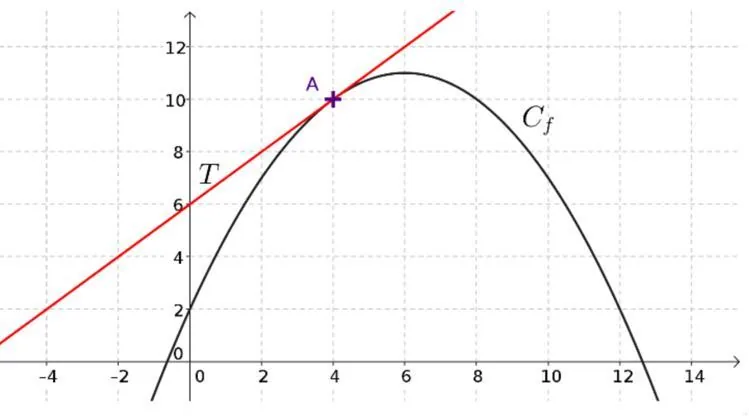

**Définition :** l'équation de la tangente à la courbe de la fonction $f$ au point $A(a,f(a))$ est : $y=f'(a)(x-a)+f(a)$ avec :

- $f'(a)$ : le nombre dérivé en $a$, c’est le coefficient directeur de la tangente ;
- $f(a)$ : l’ordonnée du point $A$.

**Exemple**

- On considère la représentation graphique $C_f$ de la fonction $f$.
- On considère la droite $(T)$ tangente à $C_f$ au point $A(4\,;10)$.
- Le nombre dérivé au point d'abscisse 4 noté $f'(4)$ est égal au coefficient directeur de la droite $(T)$. Ici $f'(4) = 1$.

On cherche l’équation de la tangente à la courbe de la fonction $f$ au point d’abscisse $x=4$ :

$y=f'(a)(x-a)+f(a)$

$y=1\times(x-4)+10$

$y = x - 4 + 10$

$y = x + 6$
