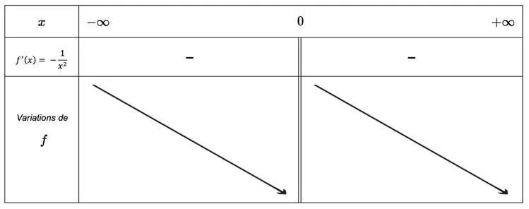
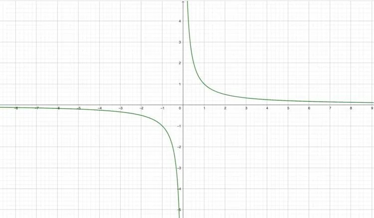

**Définition :** la fonction inverse est la fonction qui a pour expression algébrique : $f(x) = \frac{1}{x}$ avec $x \neq 0$ (la fonction $f$ n'est pas définie pour $x=0$).

La fonction $f(x) = \frac1x$ est dérivable pour tout $x \neq 0$ et sa fonction dérivée est $f'(x) = -\frac{1}{x^2}$.

On constate que, pour tout $x \neq 0$, on a $f'(x) < 0$. La fonction $f$ est donc décroissante sur $]-\infty\,;0[$ et sur $]0\,;+\infty[$.

### Tableau de signes et de variations de la fonction inverse

Attention : la double barre sous le 0 signifie que la fonction $f$ n'est pas définie en 0.

### Représentation graphique de la fonction inverse

La courbe de la représentation graphique de la fonction inverse est une hyperbole. La représentation graphique n'est pas définie pour $x = 0$.

