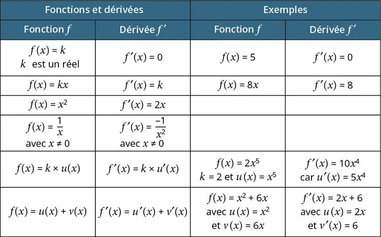

On considère une fonction $f$ définie sur un intervalle.

**Définition :** si $f$ est dérivable sur cet intervalle, alors on peut définir une nouvelle fonction, notée $f'$, appelée fonction dérivée de $f$.

On dit que, à chaque nombre $x$ de l’intervalle, la fonction dérivée $f'$ associe le nombre dérivé de $f$ en $x$, c’est-à-dire la pente de la tangente à la courbe de $f$ en ce point.

### Tableau des fonctions dérivées

Sauf mention contraire, les fonctions suivantes sont définies sur $\mathbb{R}$.

