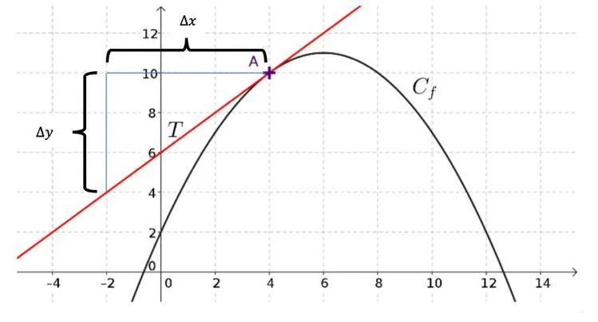

Soit $f$ une fonction de représentation graphique $C_f$, et $A(a\,;f(a))$ un point de cette courbe. On note $(T)$ la tangente à la courbe $C_f$ au point $A$.

**Définition :** on appelle nombre dérivé de la fonction $f$ en $a$ le coefficient directeur de la tangente $(T)$. On le note $f'(a)$.

**Formule :** le coefficient directeur vaut :

$\frac{\text{différence des ordonnées}}{\text{différence des abscisses}}=\frac{\Delta y}{\Delta x}$

**Exemple**

- On considère la représentation graphique $C_f$ de la fonction $f$.
- On considère la droite $(T)$ tangente à $C_f$ au point $A(4\,;10)$.
- Le nombre dérivé au point d'abscisse 4 noté $f'(4)$ est égal au coefficient directeur de la droite $(T)$.

Le coefficient directeur vaut :

$\frac{\text{différence des ordonnées}}{\text{différence des abscisses}}=\frac{\Delta y}{\Delta x}$

$\frac{\Delta y}{\Delta x}=\frac{(10-4)}{(4-(-2))}$

$\frac{\Delta y}{\Delta x}= \frac66$

$\frac{\Delta y}{\Delta x}=1$

$f'(4) = 1$
