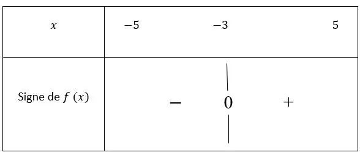

**Définition :** le signe d’une fonction $f$ dont la représentation graphique est $C_f$ permet de savoir quand la fonction est positive, négative ou nulle.

Pour une fonction $f(x)$ définie sur un intervalle $I$

- Le signe est positif si $f(x)>0$ pour tout $x$ dans $I$, ce qui signifie que la courbe $C_f$ de la fonction $f$ se situe au dessus de l'axe des abscisses.
- Le signe est négatif si $f(x)<0$ pour tout $x$ dans $I$ ce qui signifie que la courbe $C_f$ de la fonction $f$ se situe en dessous de l'axe des abscisses.
- Le signe de la fonction $f(x)$ est nul pour les valeurs de $x$ où $f(x)=0$, ce qui signifie que la courbe $C_f$ de la fonction $f$ coupe l'axe des abscisses.

**Exemple :** soit la fonction $f(x) = 2x + 6$, définie sur l’intervalle $[-5 ; 5]$.

On étudie le signe de $f(x) = 2x + 6$ sur l’intervalle $[-5\,; 5]$. Cela signifie qu'on va chercher quand la fonction est positive, négative ou nulle, entre $x = -5$ et $x = 5$.

**Astuce :** commencer par chercher la ou les solutions pour $f(x) = 0$. Ici, $f(x) = 0$ a pour solution $x = -3$. Pour étudier le signe de $f$, choisir une valeur comprise entre $[ -5 \,; -3]$ puis réaliser la même démarche en prenant une valeur comprise entre $[ -3\, ; 5]$.

- Sur $[ -5 \,; -3]$, je choisis le nombre $-4$ : $f (-4) = 2 \times (-4) + 6 = - 8 + 6 = - 2$.
Sur $[ -5 \,; -3]$, le signe de $f$ est négatif.
- Sur $[ -3\, ; 5]$, je choisis le nombre $2$ : $f (2) = 2 \times (2) + 6 = 4 + 6 = 10$.
Sur $[ -3\, ; 5]$, le signe de $f$ est positif.

On remplit le tableau de signes de la fonction $f$.

