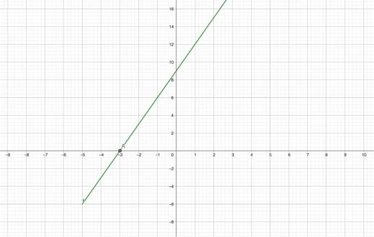
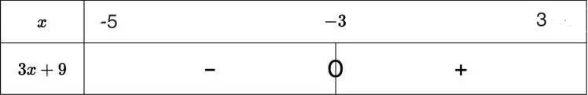

**Définition :** le signe d’une fonction $f$ dont la représentation graphique est $C_f$ permet de savoir quand la fonction est positive, négative ou nulle.

Pour une fonction $f(x)$ définie sur un intervalle $I$

- Le signe est positif si $f(x)>0$ pour tout $x$ dans $I$, ce qui signifie que la courbe $C_f$ de la fonction $f$ se situe au dessus de l'axe des abscisses.
- Le signe est négatif si $f(x)<0$ pour tout $x$ dans $I$ ce qui signifie que la courbe $C_f$ de la fonction $f$ se situe en dessous de l'axe des abscisses.
- Le signe de la fonction $f(x)$ est nul pour les valeurs de $x$ où $f(x)=0$, ce qui signifie que la courbe $C_f$ de la fonction $f$ coupe l'axe des abscisses.

**Étape 1 :** repérer les intersections de la courbe de la fonction $f$ avec l’axe des abscisses.

Chercher le ou les points où la courbe coupe l’axe des abscisses. Le ou les abscisses de ces points sont les solutions de l’équation $f(x) = 0$.

**Étape 2 :** analyser le signe de la fonction.

- Si la courbe de la fonction $f$ se situe au-dessus de l’axe des abscisses, alors $f(x) > 0$.
- Si la courbe de la fonction $f$ se situe en dessous de l’axe des abscisses, alors $f(x) < 0$.

**Étape 3 :** compléter le tableau de signes.

- Reporter l'intervalle de définition de la fonction et le ou les abscisse(s) trouvée(s) pour séparer les intervalles.
- Indiquer le signe de $f$ dans chaque intervalle, selon la position de la courbe.

**Exemple :** on étudie le signe de la fonction $f$ représentée en vert sur le graphique suivant sur l'intervalle $[-5\,;3]$.

1. La courbe de la fonction $f$ coupe l'axe des abscisse pour $x = -3$.

   L'équation $f(x) = 0$ admet une solution qui est $x = -3$.

2. La fonction est définie sur l'intervalle $[-5\,;3]$ et elle s'annule en $x = -3$.

   D'après le graphique, on constate que :

   - sur l'intervalle $[-5\,;-3]$, la courbe de la fonction $f$ se situe en dessous de l'axe des abscisses. Par conséquent $f(x) < 0$ ;
   - sur l'intervalle $[-3\,; 3]$, la courbe de la fonction $f$ se situe au-dessus de l'axe des abscisses. Par conséquent $f(x) > 0$.

3. On dresse le tableau de signes.

   
