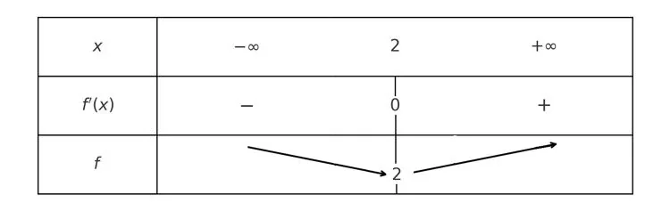

Soit $f$ une fonction définie sur un intervalle $I$.

**Définition**

- Si, pour tout $x$ de $I$, $f'(x)$ est positive, alors $f$ est croissante sur $I$.
- Si, pour tout $x$ de $I$, $f'(x)$ est négative, alors $f$ est décroissante sur $I$.

**Exemple**

Soit la fonction $f(x) = x^2 - 4x + 6$ une fonction définie sur $\mathbb{R}$.

On calcule la dérivée de la fonction $f$ : $f'(x) = 2x - 4$.

On résout $f'(x)=0$, c'est-à-dire qu'on résout l'équation $2x - 4 = 0$ qui donne $x = 2$.

- Pour $x < 2$ : $2x - 4 < 0$, donc $f'(x)$ est négative.
- Pour $x > 2$ : $2x - 4 > 0$, donc $f'(x)$ est positive.

On dessine le tableau de variations de la fonction $f$.

- Sur $] -\infty ; 2 [$, $f'(x) < 0$. La fonction $f$ est décroissante.
- Sur $] 2 ; + \infty[$, $f'(x) > 0$. La fonction $f$ est croissante.
