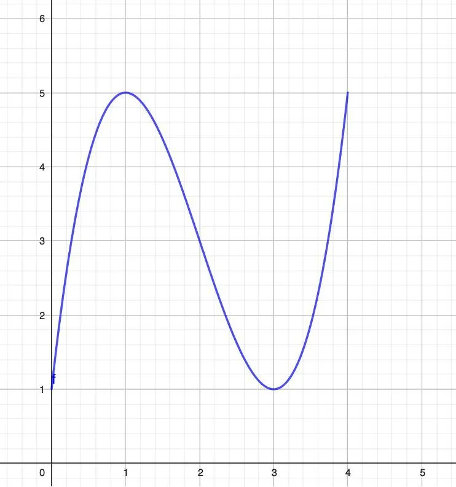

On considère la fonction $f$ dont la représentation graphique est la suivante.

1. Sur quel intervalle est définie la fonction $f$ ?

2. Dresser le tableau de variations de la fonction $f$ en s'appuyant sur le graphique.

3. La fonction $f$ admet-elle un ou des extremums ? Si oui, donner la ou les valeurs de ces extremums.
