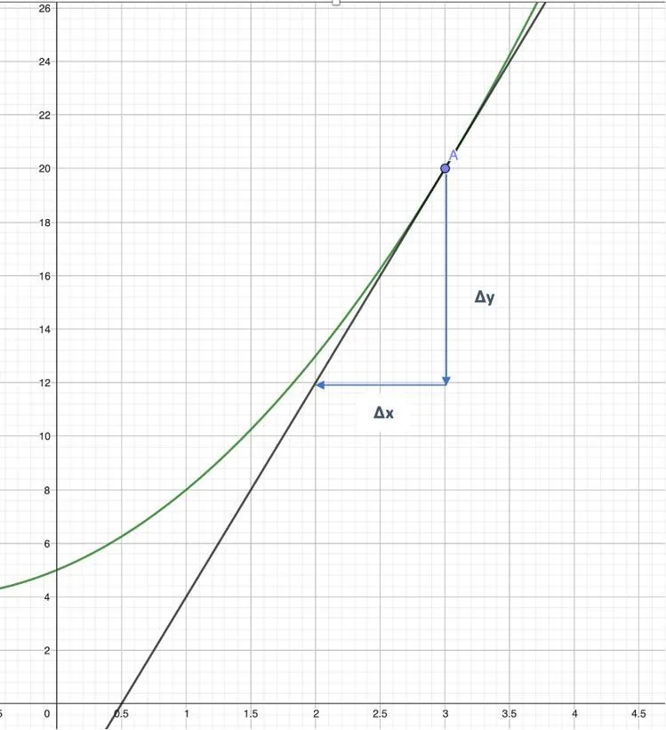

On considère la fonction $f$ telle que : $f(x) = x^2 +2x + 5$.

On souhaite déterminer graphiquement le coefficient directeur de la droite tangente à la courbe au point d'abscisse 3.

Pour déterminer le coefficient directeur de la droite tangente à la courbe, on calcule la pente $a$.

$a$ est le coefficient directeur de la droite tangente au point A.

$a = \frac{\Delta y}{\Delta x}$

**Astuce :** il faut bien observer les flèches en partant du point A puis réaliser le parcours de l'axe vertical vers l'axe horizontal.

Ici, en partant de A, on descend de 4 carreaux, ce qui équivaut avec l'échelle à $-8$, et on recule de 2 carreaux donc $-1$ selon l'échelle.

On a donc : $a =\frac{-8}{-1}=8$.

Le coefficient directeur de la tangente à la courbe de la fonction $f$ au point d'abscisse 3 est égal à 8.
