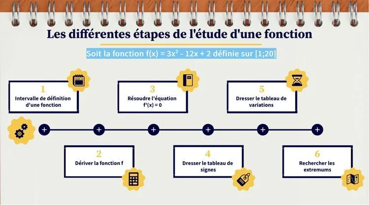
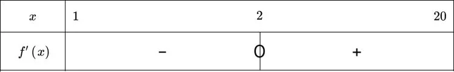
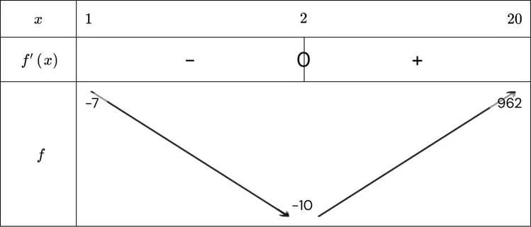

**Exemple**

Soit la fonction $f(x)=3x^2-12x+2$ définie sur $[1\,;20]$.

1. Je repère l'intervalle de définition de la fonction.

   Ici, la fonction $f$ est définie sur $[1\,;20]$.

2. Je trouve la dérivée $f'$ de la fonction $f$.

   $f'(x) = 6x - 12$

3. Je résous l'équation $f'(x)=0$ et je détermine le signe de la dérivée sur l'intervalle $[1\,;20]$.

   L'équation $6x - 12 = 0$ admet une solution : $x = 2$. Cette valeur appartient bien à l'intervalle $[1\,;20]$.

   - La dérivée $f'(x)$ est positive lorsque $6x - 12 > 0$, c'est-à-dire pour $x > 2$.
   - La dérivée $f'(x)$ est négative lorsque $6x - 12 < 0$, c'est-à-dire pour $x < 2$.

4. Je dresse le tableau de signes de $f'(x)$.

   

5. Je dresse le tableau de variations de la fonction $f$.

   

   La fonction $f$ est dérivable sur $[1\,;20]$. La dérivée $f'(x) = 6x - 12$ est négative sur $[1;2[$, nulle en $x = 2$, puis positive sur $]2;20]$. Ainsi, $f$ est décroissante sur $[1\,;2]$ et croissante sur $[2\,;20]$.

6. Je recherche les extremums de $f$ sur $[1\,;20]$.

   La fonction atteint son minimum en $x = 2$ ($f(2) = -10$) sur l'intervalle $[1\,;20]$.
