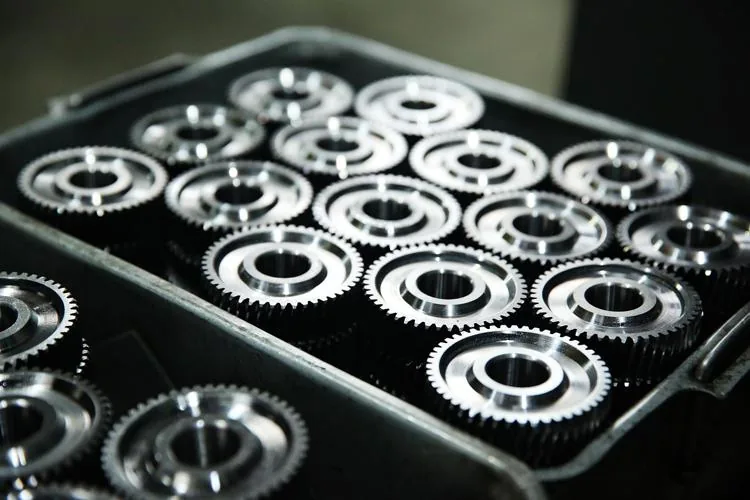

Une petite entreprise fabrique des pièces mécaniques de précision. Le bénéfice unitaire (en euro) pour chaque pièce dépend du nombre total de pièces produites. Ce bénéfice est modélisé par la fonction : $f(x)= \frac{120}x+20$ où $x$ est le nombre de pièces fabriquées avec $x \in [1\,;50]$.

::: problematique
Combien de pièces peut-on produire tout en gardant un bénéfice unitaire supérieur à 35 € ?
:::

1. À quoi correspond la fonction $f$ ? À quoi correspond la variable $x$ ?

2. Calculer $f(5)$, $f(10)$ et $f(30)$.

3. Décrire l'évolution du bénéfice en fonction du nombre de pièces produites.

4. Vérifier cette information par l'étude de la fonction $f$.

   1. Dériver la fonction $f$.
   2. Étudier le signe de la dérivée $f'$.
   3. Dresser le tableau de variations de la fonction $f$.
   4. En déduire l'évolution du bénéfice en fonction du nombre de pièces produites et vérifier la cohérence avec la question **3**.

5. Résoudre algébriquement l'inéquation $f(x) > 35$ pour tout $x \in [1\,;50]$.

6. En déduire le nombre de pièces à produire pour garder un bénéfice unitaire supérieur à 35 euros.

7. Répondre à la problématique.
