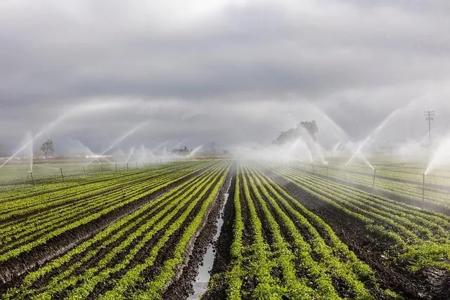

Dans une entreprise agricole, la consommation d’eau quotidienne pour l’irrigation dépend du nombre de plantes cultivées. On modélise la consommation moyenne d’eau par plante en litres par jour par la fonction $C(n)=\frac{1200}{n}+5$ définie sur l'intervalle $[1\,;200]$ où :

- $n$ est le nombre de plantes cultivées ;
- $C(n)$ est la consommation moyenne d’eau par plante (en litres par jour).

L’entreprise souhaite que chaque plante consomme au plus 25 litres d’eau par jour pour optimiser l’utilisation de l’eau.

::: problematique
Quel est le nombre minimum de plantes à cultiver pour respecter cette contrainte ?
:::

:::: competence S'approprier

1. À quoi correspond $C$ ? À quoi correspond la variable $n$ ?

2. Quel objectif veut atteindre l'entreprise pour optimiser la consommation d'eau ?

::::

:::: competence Réaliser

3. Calculer $C(10)$ et interpréter le résultat en fonction du contexte étudié (arrondir à l'unité).

   Pour la suite de l'exercice, on modélisera le problème par une fonction $f(x)=\frac{1200}{x}+5$ définie sur l'intervalle $[1\,;200]$.

4. Déterminer $f'$ la dérivée de la fonction $f$.

5. À l'aide de l'outil numérique de son choix (calculatrice NumWorks ou GeoGebra), tracer la courbe représentative de la fonction dérivée $f'$ sur l'intervalle $[1\,;200]$.

::::

:::: competence Communiquer

6. En s'appuyant sur la représentation graphique de la fonction dérivée $f'$, étudier le signe de la dérivée sur l'intervalle $[1\,;200]$.

   ::: remarque Appel
   Appeler l'enseignant pour lui expliquer l'étude du signe de la dérivée.
   :::

::::

:::: competence S'approprier · Réaliser

7. Dresser le tableau de variations de la fonction $f$ en s'appuyant sur le signe de la dérivée. (Arrondir à l'unité les valeurs du tableau.)

::::

:::: competence Analyser-raisonner

8. Interpréter le sens de variations de la fonction $f$ par rapport au contexte de l'exercice.

::::

:::: competence Réaliser

9. Résoudre algébriquement l'inéquation $f(x) \leq25$ sur l'intervalle $[1\,;200]$.

10. En déduire à partir de combien de plantes cultivées la consommation d'eau ne dépassera pas 25 litres par jour.

::::

:::: competence Communiquer

11. Répondre à la problématique.

::::
