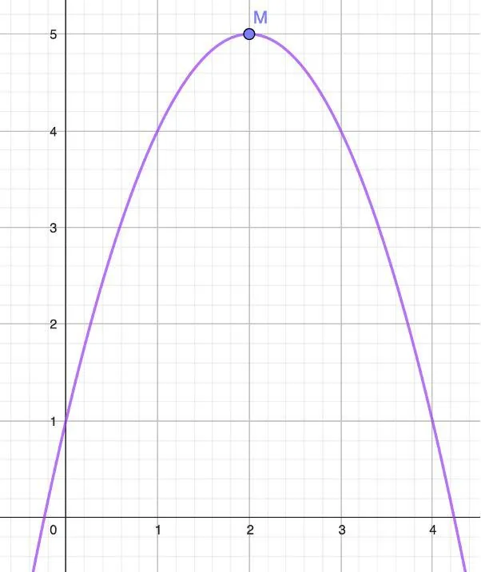

Définitions

- Si $m$ est la plus petite valeur prise par $f(x)$ alors on dit que $f$ admet un minimum. Cette valeur se lit sur l’axe des ordonnées.
- Si $M$ est la plus grande valeur prise par $f(x)$ alors on dit que $f$ admet un maximum. Cette valeur se lit sur l’axe des ordonnées.

**Exemple :** on considère la fonction $f(x) = -x^2+4 x+1$ définie sur $\mathbb{R}$. On dit que la fonction $f$ admet un maximum égal à 5 pour $x = 2$.

