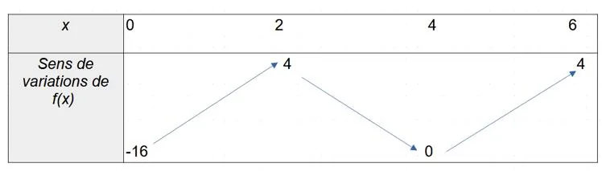
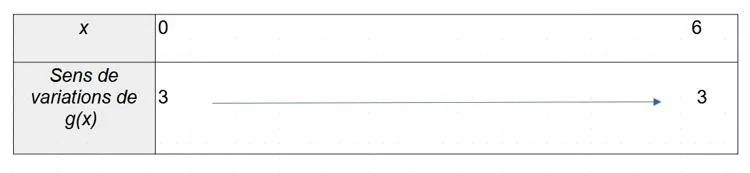

- Une fonction est croissante lorsque $x$ et $f(x)$ varient dans le même sens.
- Une fonction est décroissante lorsque $x$ et $f(x)$ varient en sens contraire.
- Une fonction est constante lorsque $f(x)$ a toujours la même valeur quelle que soit la valeur de $x$.

Les variations d'une fonction sont notées dans un tableau de variations.

**Exemple :** soient les fonctions $f$ et $g$ définies sur $[0~;6]$ dont les représentations graphiques sont les suivantes.

::: ouvrir https://www.geogebra.org/classic/q3qhfbqt
:::

- La fonction $f$ est croissante sur l'intervalle $[0~;2]$ et sur l'intervalle $[4~;6]$.
- La fonction $f$ est décroissante sur l'intervalle $[2~;4]$.
- La fonction $g$ est constante sur l'intervalle $[0~;6]$.

::: ouvrir https://www.geogebra.org/classic/q3qhfbqt
:::
