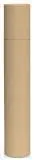
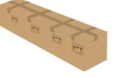
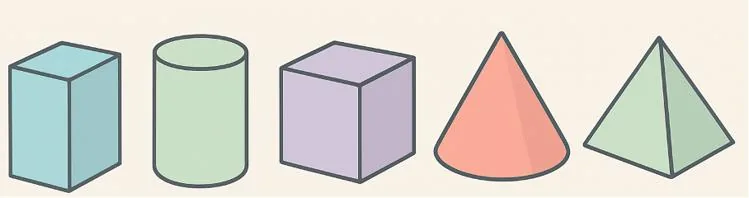

Doha est la gérante d'une boutique de cosmétiques engagée dans une démarche éco-responsable. Elle vient de recevoir une nouvelle gamme de shampoings spécialement conçue pour les cheveux bouclés.

Ce produit est très attendu par sa clientèle et il est dans un premier temps proposé à l'unité afin que les clients puissent le tester. Elle doit préparer plusieurs commandes et veut s'équiper d'emballages adaptés. Elle souhaite un conditionnement à la fois esthétique, fonctionnel et respectueux de l’environnement.

Son fournisseur lui propose deux types d'emballages.

### Emballage 1

- En forme de tube rigide.
- Dimensions : diamètre 64 mm et hauteur 170 mm.

### Emballage 2

- Sous forme de boîte classique
- Dimensions : longueur 62 mm, largeur 62 mm et hauteur 170 mm.

Voici les caractéristiques du shampoing à emballer

- Contenance de 450 mL.
- Dimensions : hauteur 165 mm, diamètre 60 mm.

::: problematique
Pour contenir une bouteille de shampoing de 450 mL, quel est l’emballage le plus économique en surface de matière utilisée et qui limite le volume d'espace perdu ?
:::

1. Citer les noms des solides usuels suivants.

   

2. Associer à l'emballage 1 le solide usuel qui lui correspond.

3. Associer à l'emballage 2 le solide usuel qui lui correspond.

4. Vérifier que les dimensions de la bouteille sont adaptées pour contenir un volume de shampoing de 450 mL.

   ::: coup-de-pouce x-volume-bouteille
   :::

5.
   1. Calculer le volume que peut contenir l'emballage 1 puis l'emballage 2.

      ::: coup-de-pouce x-volumes-emballages
      :::

   2. Convertir ces volumes en mL et préciser si ces emballages peuvent contenir le volume de shampoing.

6. On cherche à vérifier si l'emballage 1 est adapté. À l'aide de GeoGebra 3D, tracer le solide usuel modélisant l'emballage 1 ainsi que celui de la bouteille.

   ::: coup-de-pouce x-tuto-cylindre
   Le tutoriel pas à pas.
   :::

7. L'emballage 1 convient-il ?

8. On cherche à vérifier si l'emballage 2 est adapté. À l'aide de GeoGebra 3D, tracer le solide usuel modélisant l'emballage 2 ainsi que celui de la bouteille.

   ::: coup-de-pouce x-tuto-prisme
   Le tutoriel pas à pas.
   :::

9. L'emballage 2 convient-il ?

10. Quel emballage utilise la plus petite quantité de matière ? Justifier avec des calculs.

    ::: coup-de-pouce x-patron-cylindre
    :::

    ::: coup-de-pouce x-patron-pave
    :::

11. Déterminer quel emballage laisse le moins d'espace vide (en mL).

12. Conclure en répondant à la problématique.
