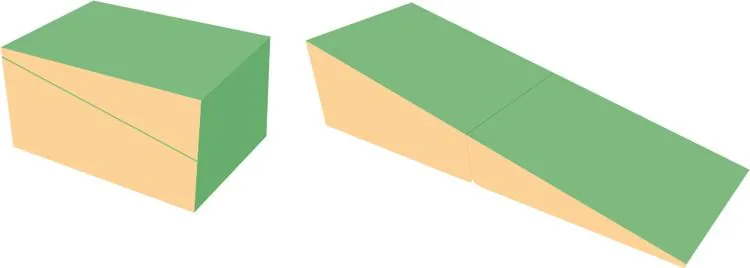

Un kinésithérapeute souhaite s’équiper de tapis en mousse à surface inclinée, faciles à ranger une fois pliés. Ces tapis sont fabriqués à partir d’un bloc de mousse parallélépipédique qui est coupé selon un plan incliné, formant une pente douce. Une fois pliés, les deux parties reprennent la forme d’un pavé droit.

Les dimensions en cm du tapis replié sont 100 x 70 x 50 cm $(L\times l\times h)$.

::: problematique
Quelles sont les dimensions de la partie verte du tapis déplié ?
:::

1. Quelle est la nature du solide usuel formé par le tapis une fois replié ?

2. Ouvrir le fichier GeoGebra 3D puis :

   - représenter le solide correspondant au tapis replié ;
   - réaliser la section de ce solide par le plan incliné ;
   - afficher une vue 2D de cette section.

   ::: coup-de-pouce x-tuto-tapis
   Le tutoriel pas à pas.
   :::

   ::: ouvrir https://www.geogebra.org/3d/mp4dgzfn
   :::

3. Quelle est la nature de la figure plane formée par cette section ?

4. En utilisant le théorème de Pythagore, calculer la longueur $EI$ (arrondir au dixième).

   ::: coup-de-pouce x-pythagore-tapis
   :::

5. Valider le résultat en affichant cette dimension sur la vue 2D.

6. En déduire la longueur de la partie verte du matelas déplié.

7. Répondre à la problématique de l'activité.
