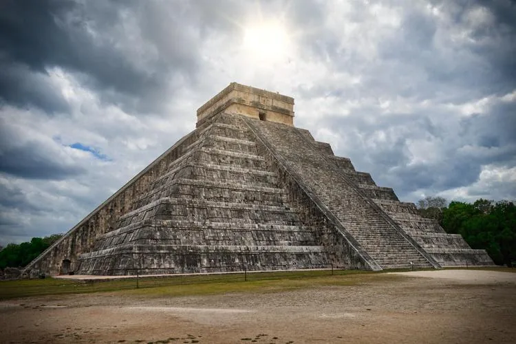
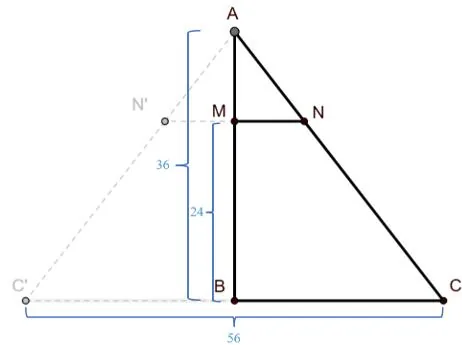

Le temple Maya de Kukulcán, au Mexique, a une base carrée de 56 m de côté. Le plateau supérieur est situé à 24 m de hauteur. La partie inférieure du temple s'inscrit dans une pyramide de 36 m de hauteur.

::: problematique
Quelle est l'aire du plateau supérieur du temple ?
:::

1. Identifier les solides usuels constituant le temple.

2. Émettre une hypothèse sur la nature de la figure plane constituant la plateforme supérieure du temple.

3. Ouvrir le fichier GeoGebra 3D

   - Utiliser l'outil **Plan parallèle** pour construire un plan parallèle au plan de la base passant par le point $H$.
   - Déplacer le point $H$ à une hauteur de 24 m.
   - Utiliser l'outil **Intersection entre deux surfaces** pour réaliser la section plane de la pyramide par le plan.
   - Faire un clic droit sur la section et créer une vue 2D.

   ::: ouvrir https://www.geogebra.org/3d/tjrnyksw
   :::

4. À l'aide du schéma de la coupe verticale de la pyramide ci-dessous, déterminer les longueurs $AM$ et $BC$.

   

5. En utilisant le théorème de Thalès, calculer la longueur $MN$. (Arrondir au dixième.)

   ::: coup-de-pouce x-thales-temple
   :::

6. En déduire les dimensions de la plateforme supérieure du temple.

7. Répondre à la problématique en justifiant la réponse par un calcul.
