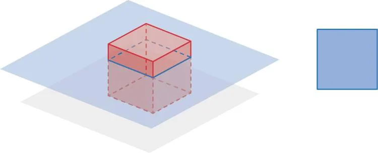
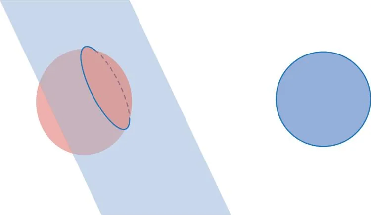
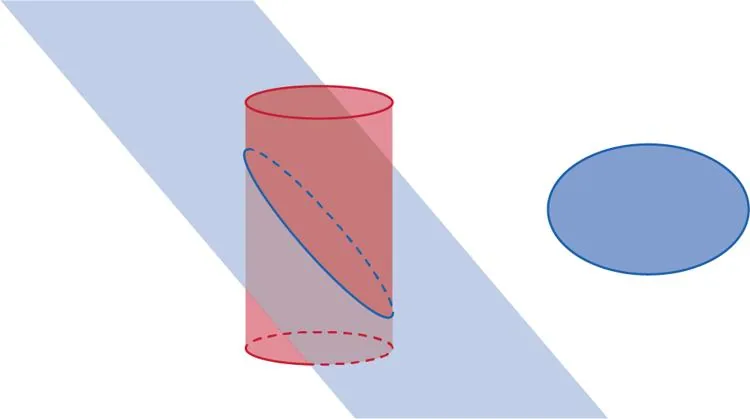

**Définition :** la section plane d'un solide est la figure géométrique obtenue par l'intersection d'un plan avec ce solide.

**Exemples**

- La section d'un cube par un plan parallèle à sa base est un carré.

- La section d'une sphère par un plan quelconque est un cercle.

- La section d'un cylindre par un plan oblique est une ellipse.

