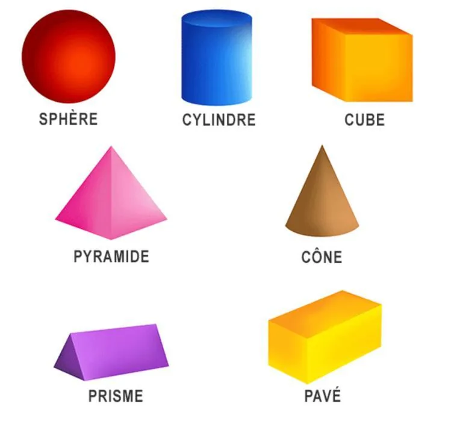
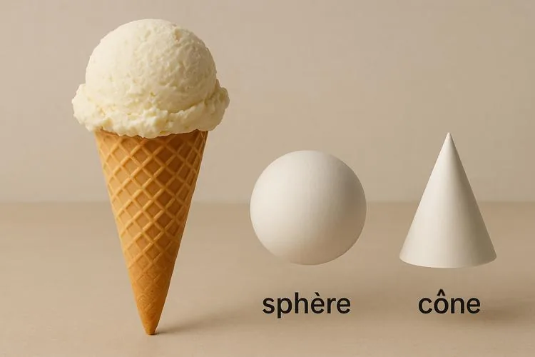

Les principaux solides usuels sont :

Certains solides sont composés de plusieurs solides usuels.

**Exemple :** un cornet de glace est composé d'un cône et d'une sphère.

On peut représenter des solides grâce à un logiciel de géométrie dynamique en 3D, comme GeoGebra 3D, qui permet de les modéliser, de les manipuler et de mieux comprendre les concepts de géométrie spatiale.
