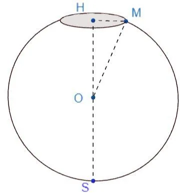

La forme d'un aquarium est obtenue en coupant une sphère de centre $O$ et de rayon 13 cm par un plan. La hauteur $HS$ de l'aquarium est 25 cm.

1. Quelle est la nature de la section plane représentant l'ouverture de l'aquarium ?

2. Quelle est la nature du triangle $OHM$ ?

3. Calculer la longueur $OH$.

4. Calculer la longueur $HM$.
