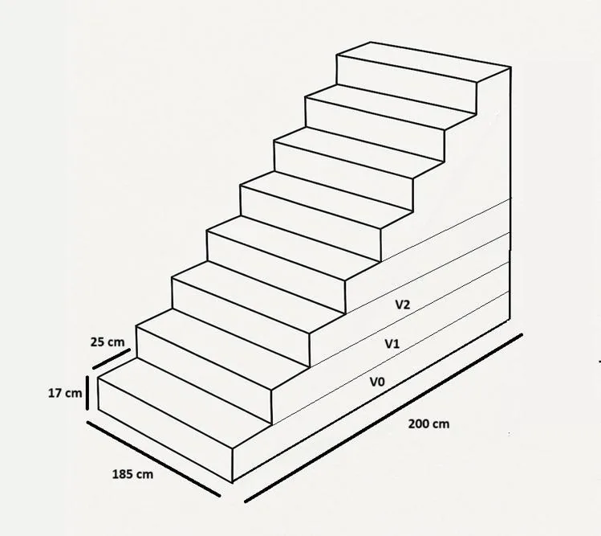

*Attention, cet exercice nécessite de maîtriser les suites arithmétiques.*

Sekou travaille dans une entreprise spécialisée dans la fabrication d’escaliers en béton. Afin de chiffrer les besoins en matières premières, il doit calculer le volume de béton nécessaire à la réalisation d’un escalier droit.

### Partie 1 — Modélisation du volume de béton nécessaire pour un escalier

On dispose des données suivantes.

- La hauteur standard d’une marche est de 17 cm.
- La profondeur standard d’une marche est de 25 cm.
- La largeur de l’escalier est de 1,80 m.
- La longueur au sol de l’escalier est de 2 m.



1. Combien de marches composent cet escalier ?

2. Calculer les volumes $V_0$, $V_1$ et $V_2$ correspondant aux trois premières marches considérées comme des parallélépipèdes rectangles.

3. Montrer que les volumes successifs des marches forment une suite arithmétique dont on précisera la raison et le premier terme.

4. À l’aide de la calculatrice NumWorks, estimer le volume total de béton nécessaire à la construction complète de l’escalier.

### Partie 2 — Généralisation et automatisation

Sekou souhaite créer un programme capable de calculer automatiquement le volume de béton nécessaire pour n’importe quel escalier droit.

1. Compléter la **ligne 21** afin de créer une variable $V_0$ correspondant au volume de la première marche à partir des données saisies par l'utilisateur.

   ::: ouvrir https://console.basthon.fr/?script=eJx1U7Fu2zAU3AXoHw7yELFNG8WjAQ2p4qIFjCRwE00BDFqiagEi6VJklsBLhwJd-xcBunXsVv9JviSUKNmGq2ggxPfujsf3HkdIaJWZimpmFHKGB1kZzpq_5fZJS4G1tAlWZ7QqmfI93xvhoxSZLm0uc1yhUVHUkrfEGpakGLfwGpopbiP5iREMtSk1A1WlXnErXn4zzPdyVjjqwiVYGw_T6BTqFIJMfA_2U0wbJaz0G4Rju6QR3iIUeIdzYreK4Azjxl5j8JJxKnJnJpdCbJ9Y7XtrVQodBnEcI7mYJXezi9vp3RyXU3zY_ry9vsLNtd1Ov9jk5-kcFhcQ31tR09RmwanKVgwxikpSHZZibazYJ5ftLthhwowTTBAQ0hwqC2m9vKpwswO8LiKWHbk-Zl9JvlRtu3pAR6mo-toc2nfumDhz-YZZnexA4f7MERIpHmwP20ZzPP_4BT5QjqPAGc6jaPja_8c6cN82N4rITT8_bnzAdGuTQtGytm7cZnCa0ij2vQ4W9y0vgtRNdSe7q_EEj2m0wdzhHx1v03S9NbT3070KLTWt9m_D91x84eLx0ByTvYl7kQ7KNDYOhSbvx8UG_N8fZ-SwLpnc_tVw9nrZpI05TauUSaMPdZ6__w7ICz3WS5s
   :::

2. À chaque nouvelle marche, on enlève un volume de béton, toujours constant, par rapport à la précédente. Comment le calculer ?

3. Compléter la **ligne 22** afin de créer une variable **raison** qui calcule le volume à enlever à chaque marche à partir des données saisies par l'utilisateur.

   Attention : il faudra que la raison soit négative !

4. Compléter la **ligne 27** en donnant à la fonction `somme_arithmetique()` ses trois arguments : le premier terme, la raison et le nombre de marches.

5. Vérifier vos résultats de la partie précédente à l'aide du programme.

   **Rappel :**

   - La hauteur standard d’une marche est de 17 cm.
   - La profondeur standard d’une marche est de 25 cm.
   - La largeur de l’escalier est de 1,80 m.
   - L'escalier compte 8 marches.

6. Compléter la **ligne 31** afin d'améliorer le programme avec une variable **cout_total** pour qu’il affiche également le coût du béton. On prendra un prix de base de $120 \,€ / \text{m}^3$.

### Partie 3 — Test du programme

Le tuteur de Sekou lui demande de chiffrer un escalier. Il lui fournit les données suivantes.

- La hauteur d’une marche est de 18 cm.
- La profondeur d’une marche est de 25 cm.
- La hauteur à franchir est de 2,16 m.
- La largeur de l’escalier est de 2,00 m.

1. Combien de marches faut-il prévoir pour atteindre la hauteur souhaitée ?

2. À l’aide du programme de chiffrage précédent, calculer le prix de revient en matériaux de cet escalier.

```python
# Calculateur de volume de béton pour escalier

# Fonction calculant la somme des n premiers termes d'une suite arithmétique
def somme_arithmetique(V0, r, n):
    return n * (2 * V0 + (n - 1) * r) / 2

# Demande des données
print("=== CALCULATEUR DE BÉTON POUR ESCALIER ===")
hauteur_marche = float(input("Hauteur d'une marche (cm) : "))
profondeur_marche = float(input("Profondeur d'une marche (cm) : "))
nb_marches = float(input("Nombre de marches : "))
largeur_escalier = float(input("Largeur de l'escalier (m) : "))
# Conversion cm → m
hauteur_marche = hauteur_marche / 100
profondeur_marche = profondeur_marche / 100

# Calcul du premier terme et de la raison de la suite arithmétique
V0=
raison =
print(f"Volume premiere marche : {V0} Raison {raison}")

#Calcul du volume total de béton
volume_total = somme_arithmetique()
print(f"\nVolume total de béton : {volume_total:.2f} m³")

# Calcul du coût 

print(f"Coût total : {cout_total:.2f} €")
```
