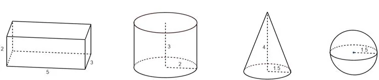

Le programme en Python suivant définit des fonctions à plusieurs paramètres qui permettent de calculer le volume des solides usuels.

- La fonction **pave()** à trois paramètres $L$, $l$ et $h$, calcule le volume d'un pavé droit de longueur $L$, de largeur $l$ et de hauteur $h$.
- La fonction **cylindre()** à deux paramètres $R$ et $h$, calcule le volume d'un cylindre de rayon $R$ et de hauteur $h$.

**Exemples**

**pave(2,3,4)** calcule $2\times 3\times 4$ et renvoie la valeur du volume du pavé droit, soit $24$.

**cylindre(2,3)** calcule $\pi\times 2^2\times 3$ et renvoie la valeur du volume du cylindre, soit environ $37{,}7$.

::: ouvrir https://console.basthon.fr/?script=eJyFzjsKwzAQBNBeoDsspIizuEqZNq0r38BYayRYfVAkQ26U9LmBLhYbo8r5TDdTPGaK3oIdkgZjg48JpZDicB14zAwqw-w5WwJ1zA7CMJcnqOhNkkLRtA7UdC23-nSRApZESjk66JBRb8tXbbyzcSrSRtXW9DssGOwRz__B8nJV8-6T9BsguAVdHvXRUmj9szPeyhVcwg
:::

1. Compléter le programme pour qu'il calcule le volume d'un cône et d'une sphère.

2. Exécuter et utiliser le programme pour calculer le volume des solides usuels suivants.
   (Arrondir au dixième si nécessaire.)

   

```python
from math import*

#Calcul du volume d'un pavé droit
def pave(L,l,h):
    return L*l*h
    
#Calcul du volume d'un cylindre
def cylindre(R,h):
    return pi*R**2*h
    
#Calcul du volume d'un cône
def cone(R,h):
    return 
    
#Calcul du volume d'une sphère
def sphere(R):
    return
```
