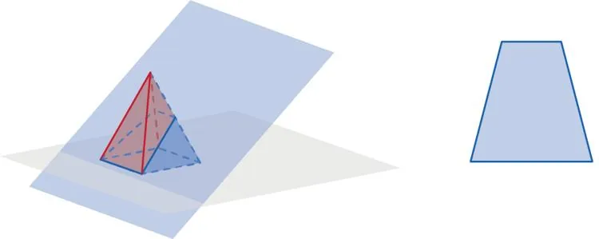

1. Ouvrir GeoGebra 3D.

2. Utiliser l'outil **Plan passant par trois points** et sélectionner 3 points appartenant au plan souhaité.

3. Déterminer les points d'intersection du plan avec les arêtes du solide et utiliser l'outil **Polygone** pour relier ces points ou utiliser l'outil **Intersection entre deux surfaces** et sélectionner le solide et le plan.

4. Sélectionner la figure formée par l'intersection du solide par le plan et faire un clic droit **Créer une vue 2D** pour afficher la section plane.

   
