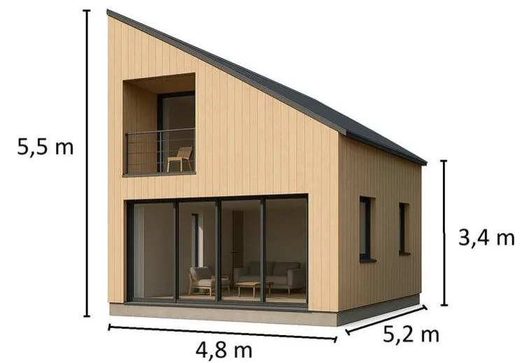
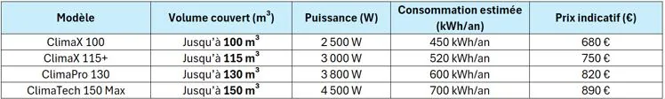
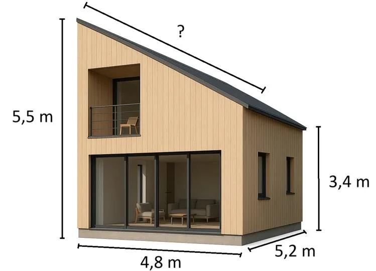

Kylian réalise son stage en bac pro Technicien du bâtiment. Son tuteur lui demande d’estimer deux éléments essentiels pour une maison en construction :

- le volume d’air intérieur, pour choisir un climatiseur adapté ;
- la surface du toit, pour estimer le coût du bardage en aluminium.

::: coup-de-pouce x-maison
:::

### Partie 1 – Estimation du volume d’air intérieur

La maison est modélisée par deux solides :

- le rez-de-chaussée (RDC) est un pavé droit de 5,2 m de long, 4,8 m de large et 3,4 m de haut ;
- l’étage correspond à une mezzanine sous un toit mono-pente, de hauteur maximale 5,5 m en forme de prisme droit de base triangulaire.

1. Calculer le volume du RDC (pavé droit).

2. Calculer le volume de l’étage (prisme droit de base triangulaire).

3. En déduire le volume total d’air dans la maison.

4. À l’aide du tableau suivant, déterminer le modèle de climatiseur à choisir pour cette maison.

   

### Partie 2 – Surface de la toiture

Le toit est un grand rectangle incliné sur la largeur de la maison. Il couvre toute la longueur du bâtiment (5,2 m). Sa largeur réelle est la longueur du versant, que l'on doit calculer avec le théorème de Pythagore.

1. Calculer la longueur du versant du toit (hypoténuse du triangle formé par la pente).

2. En déduire la surface totale de la toiture.

3. Le bardage aluminium coûte 45 €/m². Estimer le coût total du bardage.

### Partie 3 – Validation sur GeoGebra 3D

Kylian souhaite valider ses calculs en construisant un modèle 3D.

1. À l’aide du schéma de la maison, représenter les deux solides avec GeoGebra (pavé + prisme triangulaire).

2. Utiliser l’outil **Volume** pour vérifier le volume total de la maison.

3. Utiliser l’outil **Surface** pour vérifier la surface du toit.
