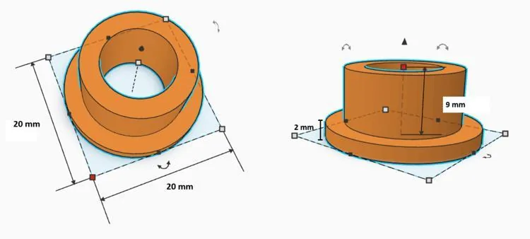
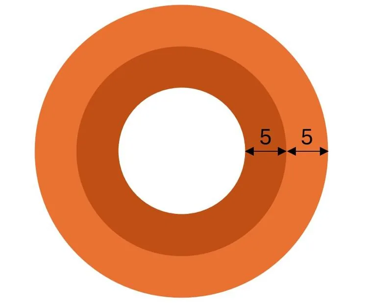

Maëlys est en bac pro Technicien en réalisation de produits mécaniques (TRPM). Elle travaille à l’atelier sur une pièce métallique de forme circulaire, usinée dans du laiton.

::: problematique
Quelle masse de laiton faut-il pour produire ces pièces pendant 30 jours ?
:::

### Pièce vue du dessous

1. Sachant qu'on peut considérer qu’il s’agit de deux couronnes cylindriques centrées avec un trou au milieu, et en utilisant les dimensions des schémas (en mm), calculer le volume de la pièce.

   ::: coup-de-pouce x-volume-cylindre
   :::

2. Le laiton a une masse volumique de $8{,}5\ \text{g/cm}^3.$ Calculer la masse de la pièce, en gramme puis en kilogramme.

3. L’usine fabrique 10 000 pièces par jour. Calculer la masse totale de laiton nécessaire pour produire pendant 30 jours.
