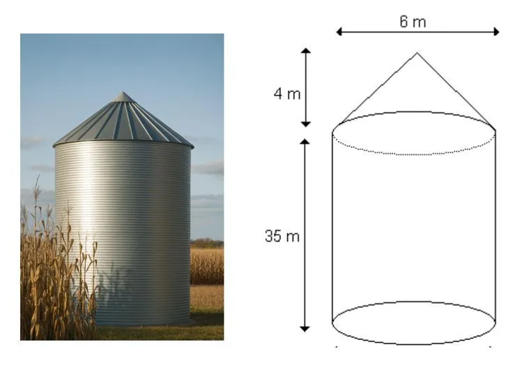

Ewan fait son stage dans une entreprise spécialisée dans l'installation de silos à grains. Il dispose du schéma ci-dessous.

::: problematique
Combien de tonnes de blé peuvent rentrer dans ce silo ?
:::

**Données :**

- Masse volumique du blé : $750 \,\text{kg/m}^3$.
- Formule du volume d'un cône : $V=\cfrac{1}{3}π×r^2×h$.
