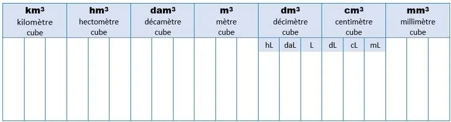

Convertir les volumes dans l'unité demandée.

1. $3\,500 \,\text{mm}^3 = \text{...}\,\text{cm}^3$

2. $2{,}4 \,\text{m}^3 = \text{...}\,\text{dm}^3$

3. $45 \,\text{m}^3 = \text{...}\,\text{mm}^3$

4. $0{,}36 \,\text{dm}^3 = \text{...}\,\text{cm}^3$

5. $65 \,\text{dm}^3 = \text{...}\,\text{m}^3$

6. $3 \,\text{dm}^3 = \text{...}\,\text{L}$

7. $1\,200 \,\text{cm}^3 = \text{...}\,\text{L}$

8. $250 \,\text{cm}^3 = \text{...}\,\text{mL}$

9. $800 \,\text{mL} = \text{...}\,\text{dm}^3$

10. $1{,}1\,\text{L} = \text{...}\,\text{cm}^3$
