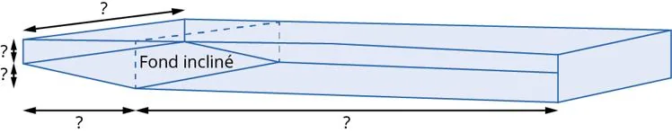

Enzo travaille pour une entreprise de travaux publics. Le gestionnaire lui a confié plusieurs missions liées à la vidange de la piscine municipale.

L’entreprise indique que le bassin a été initialement conçu avec les dimensions suivantes :

- longueur : 25 m ;
- largeur : 10 m ;
- profondeur : le fond descend progressivement de 1,20 m à 2 m de profondeur sur les 5 premiers mètres, puis reste horizontal jusqu’au bout.

:::: competence S'approprier

1. Compléter le schéma suivant à partir des données de l'exercice.

   

2. Quelles sont les formes qui composent le bassin de la piscine ?

::::

:::: competence Analyser-raisonner

3. Comment peut-on calculer le volume total de la piscine ?

::::

:::: competence Réaliser

4. Calculer le volume total d’eau contenu dans la piscine en m³.

5. Sachant que le m³ d'eau coûte 4,10 €, calculer le prix d'une vidange.

::::

:::: competence Valider

6.
   1. À l’aide du fichier GeoGebra ci-dessous, modéliser la piscine à l'aide d'une section du volume par un plan.

      ::: ouvrir https://www.geogebra.org/classic/rn9amtcn
      :::

   2. Utiliser les outils **Prisme** et **Volume** pour recréer le bassin avec son fond incliné, puis vérifier le résultat de la question précédente.

::::

:::: competence Communiquer

7. Rédiger un compte rendu technique à destination du gestionnaire de la piscine. Il doit contenir :

   - le schéma du bassin ;
   - les résultats des calculs de volume ;
   - le coût de la vidange.

::::
