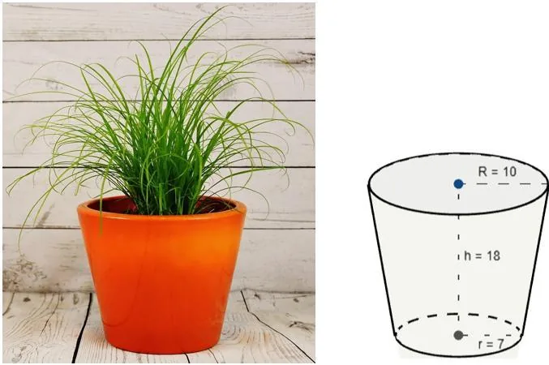

Julien achète un sac de 20 litres de terreau pour remplir des pots de fleurs. Ces pots ont une forme obtenue par la section d’un cône de révolution par un plan parallèle à sa base. Chaque pot a les dimensions suivantes :

- diamètre supérieur : 20 cm ;
- diamètre inférieur : 14 cm ;
- hauteur totale du pot : 18 cm.

::: problematique
Combien de pots Julien peut-il remplir avec un sac de 20 litres de terreau ?
:::

:::: competence S'approprier

1. Identifier le solide usuel dans lequel s'inscrit la forme du pot de fleurs.

::::

:::: competence Réaliser

2. Ouvrir le fichier GeoGebra 3D ci-dessous.

   ::: ouvrir https://www.geogebra.org/3d/jx4mvvt8
   :::

   1. Agir sur le curseur $h$ pour déterminer la hauteur totale $h_{1}$ du cône complet contenant la forme du pot.
   2. Ajuster le curseur $h$ pour que le modèle reproduise les dimensions réelles du pot.
   3. Calculer la hauteur $h_{2}$ du cône inférieur (non conservé dans le pot) ainsi formé.

::::

:::: competence Analyser-raisonner

3. Proposer une méthode pour calculer le volume du pot.

   ::: remarque Appel
   Appeler le professeur et lui expliquer la démarche.
   :::

::::

:::: competence Réaliser

4. Calculer, en $\text{cm}^3$, le volume $V_{1}$ du cône complet de diamètre 20 cm et de hauteur $h_{1}$. (Arrondir à l'unité.)

5. Calculer, en $\text{cm}^3$, le volume $V_{2}$ du cône inférieur de diamètre 14 cm et de hauteur $h_{2}$. (Arrondir à l'unité.)

6. En déduire le volume $V$ du pot et convertir ce volume en litre.

::::

:::: competence Valider · Communiquer

7. Répondre à la problématique de l'activité en justifiant la réponse par un calcul.

::::
