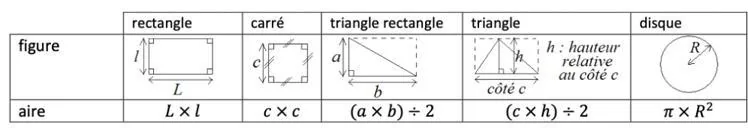

1. Observer l'animation GeoGebra en cliquant sur la petite flèche de démarrage.

   ::: ouvrir https://www.geogebra.org/classic/KNJpnzw7
   :::

2. De quelles figures géométriques est composé le patron de l'emballage 1 ? Les répertorier.

3. S'aider du tableau des aires ci-dessous pour répondre à la question. Il faudra utiliser les mesures de l'énoncé.

   
