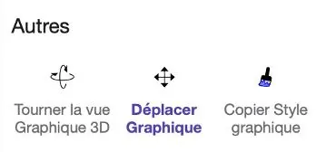
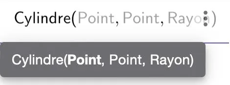
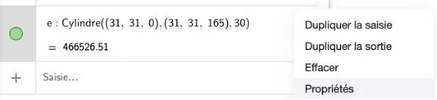

1. Ouvrir GeoGebra calculatrice 3D.

### Réglage de l'échelle du graphique

2. Aller dans la fenêtre **« Outils »**.

   

3. Aller dans la rubrique **« Autres »** et sélectionner **« Déplacer graphique »**.

   

4. Placer le curseur sur chacun des axes du graphique ($x$, $y$, $z$) puis modifier pour afficher des graduations de 20 en 20.

### Construction de l'emballage 1

5. Dans la fenêtre **« Algèbre »**, dans la partie **« Saisie »**, taper la fonction **« Cylindre »** et choisir **« Cylindre (Point, point, Rayon) »**.

   

6. Saisir les données :

   - 1er point : (32,32,0)
   - 2e point : (32,32,170)
   - Rayon : 32

   Puis cliquer sur la touche **« Entrée »**.

### Construction de la bouteille de shampoing

7. Réaliser la même manipulation pour construire le solide correspondant à la bouteille de shampoing avec les données :

   - 1er point : (31,31,0)
   - 2e point : (31, 31, 165)
   - Rayon : 30

   Puis cliquer sur la touche **« Entrée »**.

8. Changer la couleur de ce volume pour le mettre en vert. Dans la fenêtre **« Algèbre »**, dans la partie **« Saisie »**, se rendre sur l'item du solide et cliquer sur les 3 petits points, puis sur **« Propriété »**.

   

9. Dans l'onglet **« Couleur »** choisir la couleur verte puis revenir sur le graphique.

10. Félicitations ! Vous avez représenté la bouteille de shampoing en vert et l'emballage en forme de tube cylindrique en rouge.

    ::: ouvrir https://www.geogebra.org/3d/mr38wm8s
    :::
