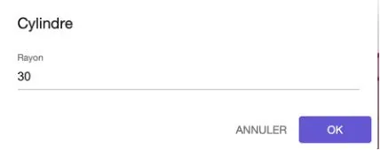
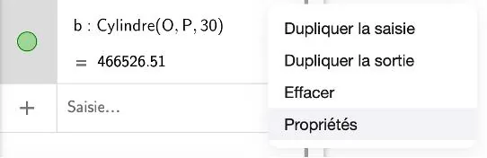

1. Ouvrir GeoGebra calculatrice 3D.

### Réglage de l'échelle du graphique

2. Aller dans la fenêtre **« Outils »**.

   

3. Aller dans la rubrique **« Autres »** et sélectionner **« Déplacer graphique »**.

   

4. Placer le curseur sur chacun des axes du graphique ($x$, $y$, $z$) puis modifier pour afficher des graduations de 20 en 20.

### Construction de l'emballage 2

5. Il faut tout d'abord construire la base de l'emballage qui est un carré. Pour cela, dans la fenêtre **« Algèbre »**, dans la partie **« Saisie »**, saisir les coordonnées A, B, C et D des sommets de la base de la façon suivante :

   - A = (0,0,0) puis taper sur la touche **entrée** du clavier ;
   - B = (62,0,0) puis taper sur la touche **entrée** du clavier ;
   - C = (62,62,0) puis taper sur la touche **entrée** du clavier ;
   - D = (0,62,0) puis taper sur la touche **entrée** du clavier.

6. On doit ensuite relier les 4 points pour former la base du solide. Pour cela :

   - Dans la fenêtre **« Outils »**, dans la rubrique **« Lignes et polygones »**, cliquer sur l'outil **« Segment »**.
   - Cliquer sur le point A, puis sur B : un segment s'affiche.
   - Faire la même chose pour relier B à C, puis C à D puis D à A.

   La base du solide apparaît sur le graphique.

7. Tracer le point H, hauteur du solide en allant dans la fenêtre **« Algèbre »**, dans la partie **« Saisie »** et en saisissant les coordonnées du point H = (0,0,170). Ne pas oublier de taper sur la touche **entrée** du clavier.

8. Extruder la base du solide pour obtenir un volume. Pour cela, dans la fenêtre **« Outils »**, dans la partie **« Solide »**, cliquer sur **« Prisme »** puis cliquer simultanément sur les points A, B, C, D et H. Le volume apparaît sur le graphique.

### Construction de la bouteille de shampoing

9. Dans la fenêtre **« Algèbre »**, dans la partie « **Saisie »**, saisir les coordonnées du centre du cercle O et les coordonnées du point P, hauteur de la bouteille :

   - O = (31,31,0) puis taper sur la touche **entrée** du clavier ;
   - P = (31, 31, 165) puis taper sur la touche **entrée** du clavier.

10. Dans la fenêtre **« Outils »**, dans la partie **« Solide »**, cliquer sur **« Cylindre »** puis sélectionner sur le graphique les points O et P. Une fenêtre **« Rayon »** apparaît.

    

11. Saisir la valeur 30 pour le rayon, puis cliquer sur **« OK »**. Le volume apparaît.

12. Changer la couleur de ce volume pour le mettre en vert. Dans la fenêtre **« Algèbre »**, dans la partie **« Saisie »**, se rendre sur l'item du solide et cliquer sur les 3 petits points, puis sur **« Propriété »**.

    

13. Dans l'onglet **« Couleur »** choisir la couleur verte puis revenir sur le graphique.

14. Félicitations ! Vous avez représenté la bouteille de shampoing en vert et l'emballage classique 2 en rouge.

    ::: ouvrir https://www.geogebra.org/3d/ywwb5n8j
    :::
