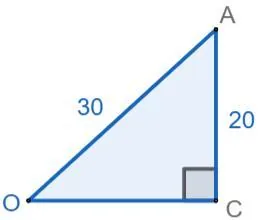

Dans le triangle $OCA$ rectangle en $C$ :

$OA$ est le rayon de la sphère donc $OA=\frac{60}{2}=30~\text{mm}$.

$CA$ est le rayon de l'ouverture circulaire donc $CA=\frac{40}{2}=20~\text{mm}$.

D'après le théorème de Pythagore : $OA^2=OC^2+CA^2$.
